# PRD — Kardiologiku
**Aplikasi mobile deteksi dini dan edukasi aritmia jantung berbasis Teorema Bayes**

| | |
|---|---|
| Versi | 1.1 (siap eksekusi) |
| Tanggal | 24 Nov 2026 |
| Mata kuliah | Sistem Berbasis Pengetahuan (SBP), Universitas Indraprasta PGRI Jakarta |
| Kelompok | Kelompok 4 (Teorema Bayes), kelas R7L |
| Pasangan dokumen | `AGENTS.md`, `DESIGN.md`, `kb-seed.v0.1.json` |
| Status data klinis | `estimasi` (belum divalidasi pakar) |

> Dokumen ini adalah **sumber kebenaran** perilaku, data, algoritma, fase, dan task. Agent wajib mengikuti `AGENTS.md` dalam mengerjakannya.

---

## 1. Ringkasan eksekutif
**Kardiologiku** membantu orang awam mengenali kemungkinan jenis **aritmia** dari denyut, gejala, faktor risiko, dan (opsional) data EKG. Mesin intinya adalah **Teorema Bayes** (Naive Bayes multi-bukti) yang membaca **basis pengetahuan** (prior dan likelihood dari literatur), lalu menampilkan 3 kemungkinan teratas, tanda bahaya, dan penjelasan langkah demi langkah ("Kenapa hasilnya begini?").

Pembeda utama: **jantung 3D dengan impuls listrik** dan **EKG sintetis yang sinkron** untuk menjelaskan hasil secara visual (termasuk WPW dan SVT re-entry). Modul **Belajar** menyatukan artikel interaktif bergambar, kuis adaptif, dan gamifikasi lembut: penguasaan topik dilacak dengan **Bayesian Knowledge Tracing**, pemilihan soal memakai information gain, dan rekomendasi bacaan dibobot oleh posterior hasil deteksi.

**Bukan** alat diagnosis medis. **Bukan** machine learning. **Tanpa LLM.**

### 1.1 Tujuan produk
1. Mendeteksi dini 12 jenis irama jantung dengan penalaran probabilistik yang transparan.
2. Mengedukasi lewat simulasi 3D sistem konduksi dan EKG interaktif.
3. Menjadi contoh sistem berbasis pengetahuan lengkap: basis pengetahuan, mesin inferensi, antarmuka, fasilitas penjelasan, akuisisi pengetahuan.

### 1.2 Non-tujuan
- Mendiagnosis, meresepkan, atau menggantikan dokter/EKG.
- Membaca EKG pasien asli atau mengimpor sinyal EKG.
- Machine learning, LLM, sinkronisasi antar perangkat, target web.

### 1.3 Metrik keberhasilan (untuk laporan)
| Metrik | Target |
|---|---|
| 12 kasus emas engine (Lampiran B) | 100% lolos |
| Tes emas BKT dan gamifikasi (Lampiran F) | 100% lolos |
| Akurasi top-3 vs kasus rujukan literatur (T-601) | dilaporkan apa adanya (tidak ada ambang lulus; analisis wajib) |
| Skor SUS (T-602) | ≥ 68 (rata-rata ≥ 10 responden) |
| Kecepatan inferensi | < 20 ms (24 bukti) |
| Frame simulasi | 60fps target, minimal 30fps di perangkat menengah |

## 2. Konteks akademik dan pemetaan ke formulir
Judul penelitian: *Implementasi Teorema Bayes pada Aplikasi Mobile "Kardiologiku" untuk Deteksi Dini dan Edukasi Aritmia Jantung dengan Simulasi 3D Sistem Konduksi Listrik Jantung dan Elektrokardiogram Interaktif*.

| Tujuan di formulir | Modul | Task utama |
|---|---|---|
| 1. Menyusun basis pengetahuan aritmia dari pedoman klinis dan jurnal | Knowledge base | T-101, T-102, T-506, T-507 |
| 2. Mengimplementasikan Teorema Bayes sebagai mesin inferensi | Engine | T-104, T-105, T-301, T-302 |
| 3. Simulasi 3D sistem konduksi dan EKG interaktif | Simulasi | T-400 s.d. T-409 |
| 4. Menguji kesesuaian dengan kasus rujukan literatur dan kemudahan penggunaan | Pengujian | T-601, T-602 |

Pemetaan komponen sistem pakar: **basis pengetahuan** = tabel prior/likelihood; **mesin inferensi** = Bayes; **working memory** = bukti yang diinput; **fasilitas penjelasan** = "Kenapa hasilnya begini?"; **akuisisi pengetahuan** = seed dari literatur + Mode Pakar; **antarmuka** = aplikasi mobile.

Referensi awal formulir: Martis dkk. 2013 (AF, Naive Bayes); Samadova dkk. 2022 (BBN aritmia ventrikel); Wulandari dkk. 2020 (sistem pakar Bayes, jantung koroner).

## 3. Keputusan terkunci
Lihat `AGENTS.md` §3 (DEC-01 s.d. DEC-10). Tambahan keputusan produk:
| ID | Keputusan | Alasan |
|---|---|---|
| DEC-11 | Admin pertama dibuat lewat layar **Setup Admin** saat pertama kali app dibuka (bukan akun default). | Tidak ada kata sandi bawaan yang bocor. |
| DEC-12 | Berita dikurasi manual oleh Pakar/Admin (tambah tautan) + feed JSON opsional. **Tanpa scraping.** Seed berita kosong. | Menghindari berita palsu/hak cipta. |
| DEC-13 | Jurnal: hanya metadata + tautan PubMed, **tanpa abstrak/teks penuh**. | Hak cipta. |
| DEC-14 | Simulasi 3D memakai flag `USE_3D`; fallback 2D SVG wajib ada. | Risiko kompatibilitas R3F di Expo. |
| DEC-15 | Blok AV pada simulasi = varian **2:1** (mudah divisualkan). | Penyederhanaan edukasi. |
| DEC-16 | Pertanyaan kuis dibangkitkan dari KB (sintetis), bukan pasien nyata. | Etika dan data. |
| DEC-17 | Jantung 3D dibuat **prosedural dari primitif** (elipsoid, tube, bola), **tanpa GLB/aset eksternal**; spesifikasi lengkap di Lampiran E. GLB hanya opsi lanjutan. | Tanpa masalah lisensi dan loader GLB di React Native, bagian bernama langsung bisa dianimasikan, dan cocok dikerjakan agent tanpa langkah manual. |
| DEC-18 | Styling memakai **NativeWind v4.2.x (Tailwind v3)** dengan `theme.colors` di-override penuh. **Bukan v5** (RC, belum untuk produksi), bukan gluestack (bergantung v5 dan menghasilkan tampilan generik). | Stabil, dikenal baik oleh agent, dan mudah ditegakkan lewat skrip pemeriksa kelas. |
| DEC-19 | Gerak UI: Reanimated 4 (CSS transitions untuk state sederhana, layout animations untuk masuk/keluar, shared value + worklet hanya untuk EKG/gestur). Strip EKG dan glow: **Skia**. | Gerak halus di UI thread; Skia memberi glow dan kisi yang rapi. |
| DEC-20 | Tipografi: **Fraunces** (judul serif), **Instrument Sans** (UI), **JetBrains Mono** (angka). Ikon: **Lucide**. | Kontras serif-mono memberi identitas editorial-klinis dan menjauhkan dari tampilan generik. |
| DEC-21 | Modul Belajar memakai pelacak penguasaan **Bayesian Knowledge Tracing** + pemilihan soal adaptif (information gain) + rekomendasi bacaan berbobot posterior deteksi. | Menyatukan edukasi dengan engine Bayes secara nyata, bukan dekorasi. Parameter BKT adalah estimasi. |
| DEC-22 | Gambar artikel = ilustrasi kode + maks 12 gambar **CC0/Public Domain/CC BY** beratribusi. Lisensi tak terverifikasi = tidak dipakai. | Hak cipta; konsistensi gaya. |
| DEC-23 | Logo utama = **jantung realistis berlisensi + jejak EKG animasi**; **tanda vektor** buatan sendiri untuk ukuran kecil dan ikon. Tidak mengambil logo/stok bermerek. | Sesuai permintaan pemilik; aman lisensi dan terbaca di ukuran kecil. |
| DEC-24 | Gamifikasi lembut: XP, level, streak (dengan pembekuan mingguan), lencana, Peta Belajar. Tanpa leaderboard, nyawa, atau notifikasi dorong. | Motivasi tanpa tekanan pada konteks kesehatan. |

## 4. Persona dan role
**Persona:** (a) *Orang awam* yang berdebar dan ingin tahu; (b) *Mahasiswa/peneliti* yang ingin melihat cara kerja Bayes; (c) *Pakar/dosen* yang mengecek dan mengubah basis pengetahuan; (d) *Admin* yang mengelola akun.

### 4.1 Matriks RBAC
| Kemampuan | Tamu | User | Pakar | Admin |
|---|:-:|:-:|:-:|:-:|
| Deteksi, Hasil, Kenapa, What-if, Tap Nadi | ✓ | ✓ | ✓ | ✓ |
| Simulasi, Artikel, Kuis, Peta Belajar (progres dan XP tidak tersimpan untuk Tamu) | ✓ | ✓ | ✓ | ✓ |
| Simpan dan lihat Riwayat + tren | – | ✓ | ✓ | ✓ |
| Ekspor PDF | – | ✓ | ✓ | ✓ |
| Hapus riwayat/akun sendiri | – | ✓ | ✓ | ✓ |
| Mode Pakar: ubah prior/likelihood/status/sumber, kurasi artikel/soal/berita | – | – | ✓ | ✓ |
| Ekspor/impor basis pengetahuan (JSON) | – | – | ✓ | ✓ |
| Kelola pengguna (ubah role, nonaktifkan, hapus) | – | – | – | ✓ |
Pewarisan: Tamu ⊂ User ⊂ Pakar ⊂ Admin. Pendaftaran mandiri selalu menghasilkan **User**.

## 5. Ruang lingkup dan daftar fitur
Prioritas: **M**=Must, **S**=Should, **C**=Could.
| ID | Fitur | Prioritas | Fase |
|---|---|:-:|:-:|
| F-01 | Onboarding + persetujuan disclaimer | M | 1 |
| F-02 | Deteksi wizard Awam/Lanjutan, jawaban Ya/Tidak/Tidak tahu | M | 1 |
| F-03 | Mesin Bayes 12 hipotesis × 24 variabel | M | 1 |
| F-04 | Tanda bahaya (red flag) + tombol darurat | M | 1 |
| F-05 | Hasil top 3, saran, status data | M | 1 |
| F-06 | "Kenapa hasilnya begini?" | M | 1 |
| F-07 | Probabilitas live saat menjawab | M | 1 |
| F-08 | Riwayat (+ tren) | M | 2-3 |
| F-09 | Auth lokal, mode Tamu, RBAC, Setup Admin | M | 2 |
| F-10 | Pertanyaan adaptif (information gain) | S | 3 |
| F-11 | "Bagaimana kalau?" (what-if) | S | 3 |
| F-12 | Tap Nadi | S | 3 |
| F-13 | Ekspor PDF | S | 3 |
| F-14 | Simulasi jantung 3D + impuls + EKG sinkron + haptic | M | 4 |
| F-15 | Mode WPW dan SVT re-entry | M | 4 |
| F-16 | Referensi: jurnal (PubMed), berita, mitos/fakta, glosarium, cache offline | S | 5 |
| F-17 | Kuis Pasien Virtual (salah satu mode Kuis) | S | 5 |
| F-18 | Mode Pakar (editor KB + log) | M | 5 |
| F-19 | Ekspor/impor KB JSON | S | 5 |
| F-20 | Kelola pengguna (admin) | S | 2 |
| F-21 | Pengaturan (tema, haptic, reduce motion, 3D/2D, hapus data, tentang & sumber) | M | 1-5 |
| F-22 | Artikel interaktif bergambar (blok, widget, cek-paham) | S | 5 |
| F-23 | Bank soal + Kuis (7 tipe soal, 5 mode) | S | 5 |
| F-24 | Pelacak penguasaan Bayesian (BKT) + Peta Belajar | S | 5 |
| F-25 | Rekomendasi belajar dari hasil deteksi | S | 5 |
| F-26 | Gamifikasi lembut (XP, level, streak, lencana) | S | 5 |
| F-27 | Logo, splash, ikon, onboarding dan login interaktif | M | 0-2 |
**Di luar lingkup v1:** sinkronisasi cloud, notifikasi, import sinyal EKG, multi-bahasa, web.

## 6. Arsitektur dan tech stack
### 6.1 Diagram arsitektur
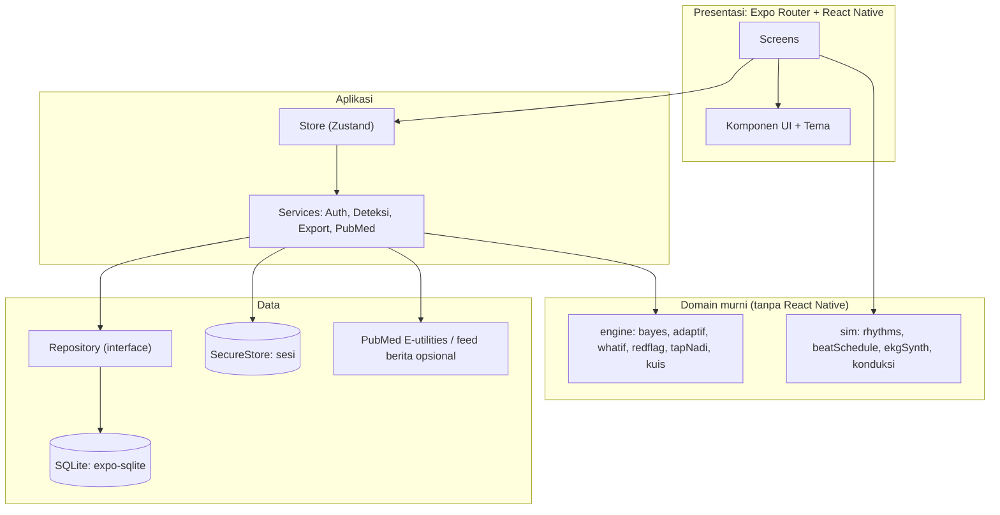

### 6.2 Struktur folder
Lihat `AGENTS.md` §5. Tambahan rute `app/`:
```
app/_layout.tsx                  # provider, font, gerbang sesi
app/index.tsx                    # redirect sesuai state (setup/onboarding/auth/tabs)
app/(setup)/setup-admin.tsx
app/(onboarding)/index.tsx
app/(auth)/login.tsx  daftar.tsx
app/(tabs)/_layout.tsx
app/(tabs)/index.tsx             # Beranda
app/(tabs)/simulasi.tsx          # daftar irama
app/(tabs)/deteksi.tsx           # wizard
app/(tabs)/edukasi.tsx
app/(tabs)/profil.tsx
app/hasil.tsx  kenapa.tsx  whatif.tsx  tap-nadi.tsx  kuis.tsx
app/simulasi/[irama].tsx
app/edukasi/artikel/[id].tsx  edukasi/jurnal.tsx  edukasi/berita.tsx
app/riwayat/index.tsx  riwayat/[id].tsx
app/pakar/index.tsx  pakar/hipotesis/[id].tsx  pakar/variabel/[id].tsx  pakar/berita.tsx
app/admin/pengguna.tsx
app/pengaturan.tsx  app/tentang.tsx
```

### 6.3 Daftar library (di luar ini = minta izin)
| Kebutuhan | Library |
|---|---|
| Framework | `expo` (SDK terbaru dari `create-expo-app`, per Nov 2026 = SDK 57), `expo-router`, `react-native`, TypeScript strict |
| Styling | `nativewind@4.2.x` + `tailwindcss@^3.4.17` + `prettier-plugin-tailwindcss` (**NativeWind v4, bukan v5**; v5 masih RC per 13 Sep 2026) |
| Animasi UI | `react-native-reanimated` 4.x + `react-native-worklets` (CSS transitions/animations, layout animations), `react-native-gesture-handler` |
| State | `zustand` |
| Validasi | `zod` |
| DB | `expo-sqlite` (API async) |
| Sesi | `expo-secure-store` |
| Hash/acak | `expo-crypto` (random) + `@noble/hashes` (PBKDF2-SHA256) |
| Strip EKG dan efek visual | `@shopify/react-native-skia` (jejak + glow + kisi), `react-native-svg` (jantung 2D, grafik tren) |
| 3D | `three`, `@react-three/fiber` (native), `expo-gl`, `expo-asset` |
| Haptic | `expo-haptics` |
| PDF/bagikan | `expo-print`, `expo-sharing` |
| Font | `expo-font`, `@expo-google-fonts/fraunces`, `@expo-google-fonts/instrument-sans`, `@expo-google-fonts/jetbrains-mono` |
| Ikon | `lucide-react-native` (garis tipis, stroke 1.75) |
| Gambar | `expo-image` (cache, WebP) |
| Tes | `vitest` (engine/sim/data), `@testing-library/react-native` (komponen kunci) |
| Lint | `eslint`, `prettier` |
Catatan: pasang lewat `npx expo install`. Versi `three` harus kompatibel dengan `@react-three/fiber`; putuskan di spike T-400. Reanimated 4 hanya mendukung New Architecture (default di SDK terbaru). Pasangan versi Reanimated/worklets/Gesture Handler **ikut definisi bundel SDK** (jangan dinaikkan sendiri). Konfigurasi NativeWind (babel, metro, `global.css`, `tailwind.config.js`) ada di DESIGN §15.

### 6.4 Keamanan lokal
- Password: `PBKDF2-HMAC-SHA256`, ≥ 100.000 iterasi, salt acak 16 byte (`expo-crypto`), simpan `kdf` dan parameter di tabel `users`. Bandingkan hash dengan perbandingan waktu-konstan.
- Pembatasan percobaan: 5 gagal berturut-turut ⇒ tunda 30 detik (disimpan di memori + `app_meta`).
- Sesi di `expo-secure-store` (`{userId, expiresAt}`), kedaluwarsa 30 hari. Logout menghapusnya.
- SQL parameterized. Validasi semua input dengan `zod`.
- Batasan jujur: karena lokal, role hanya pembatas tampilan. Tulis ini di laporan.

## 7. Navigasi dan flow
### 7.1 Peta navigasi
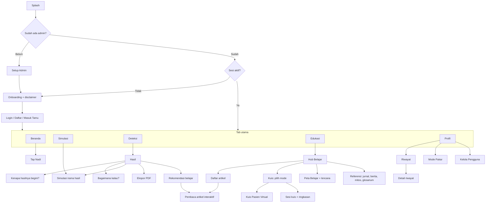

### 7.2 Flow aktivitas Deteksi
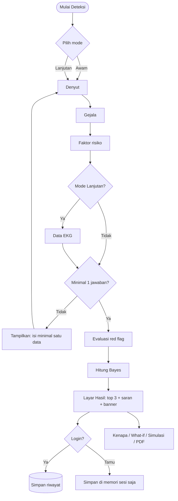
Selama wizard, setiap jawaban memicu **perhitungan ulang** dan panel **probabilitas live** diperbarui. Pengguna boleh ke layar Hasil kapan saja (tombol "Cukup, lihat hasil").

### 7.3 Sequence: inferensi
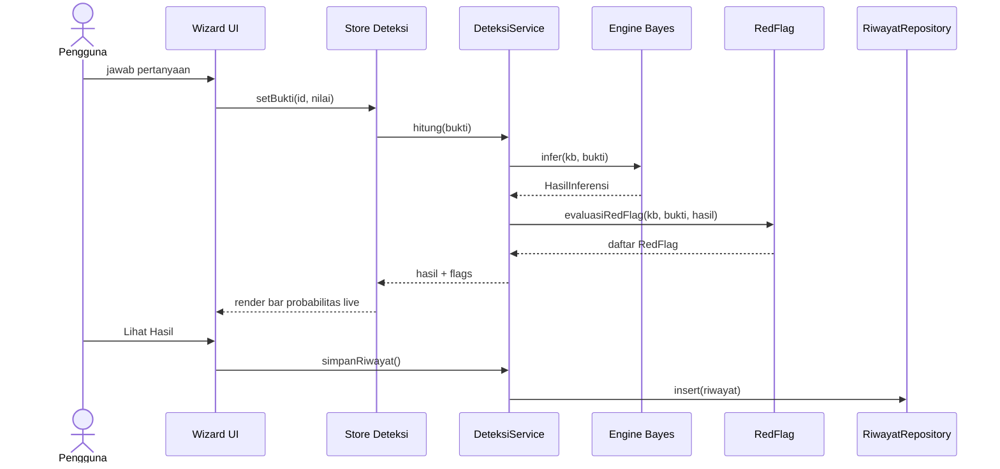

### 7.4 Sequence: login dan setup admin
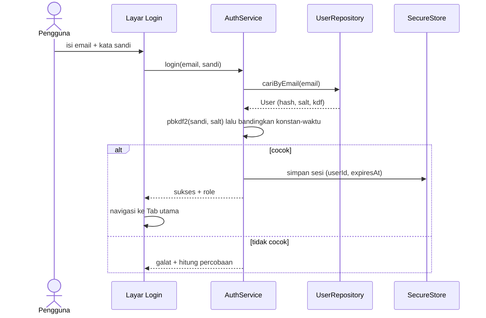

### 7.5 Sequence: Mode Pakar mengubah KB
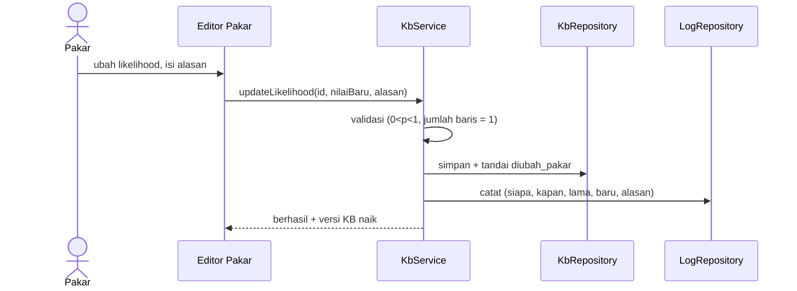

## 8. Use case
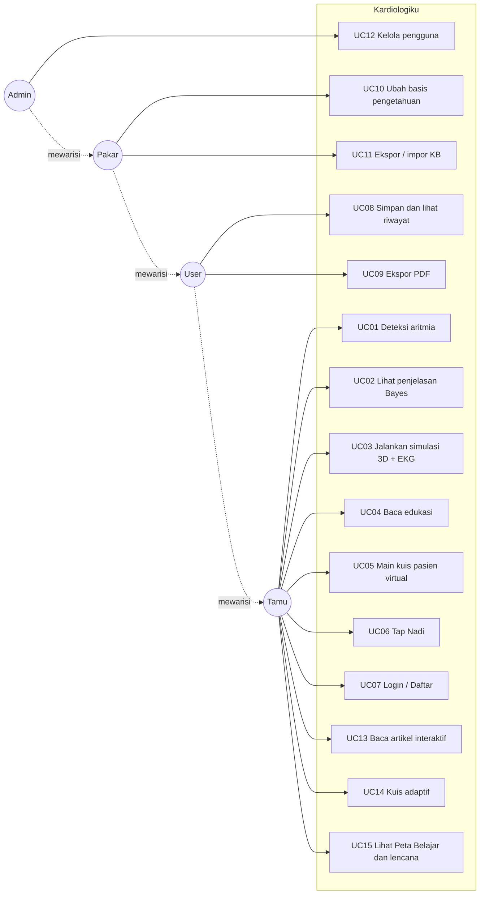
| UC | Prasyarat | Alur utama | Hasil |
|---|---|---|---|
| UC01 | Onboarding selesai | Pilih mode → jawab → lihat hasil | Top 3 + saran + red flag |
| UC02 | Ada hasil | Buka Kenapa | Langkah Bayes tampil |
| UC03 | – | Pilih irama → putar | Jantung 3D + EKG sinkron |
| UC08 | Login | Selesai deteksi | Riwayat tersimpan + tren |
| UC10 | Role pakar/admin | Pilih hipotesis/variabel → ubah → alasan | KB naik versi + log |
| UC12 | Role admin | Pilih pengguna → ubah role/nonaktifkan | Perubahan tercatat |

---

## 9. Model domain (kontrak kode)
### 9.1 Class diagram: pengetahuan dan engine
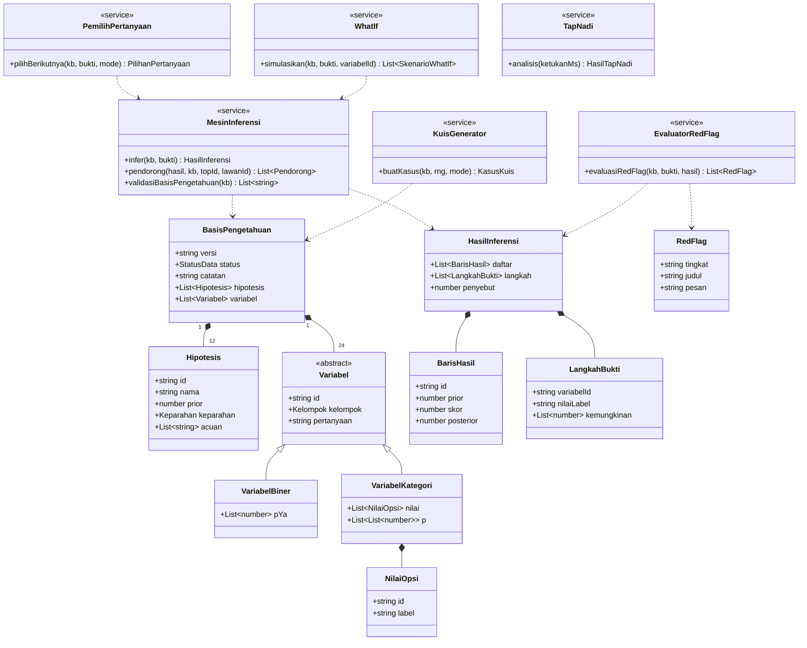

### 9.2 Class diagram: aplikasi dan data
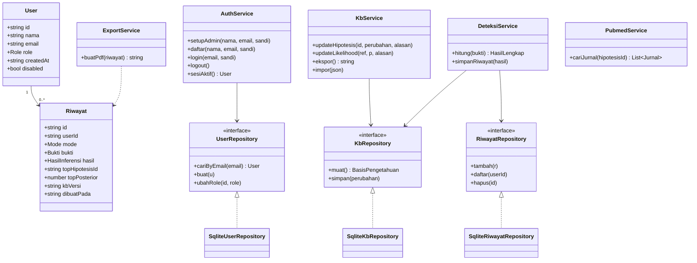

### 9.3 Class diagram: simulasi
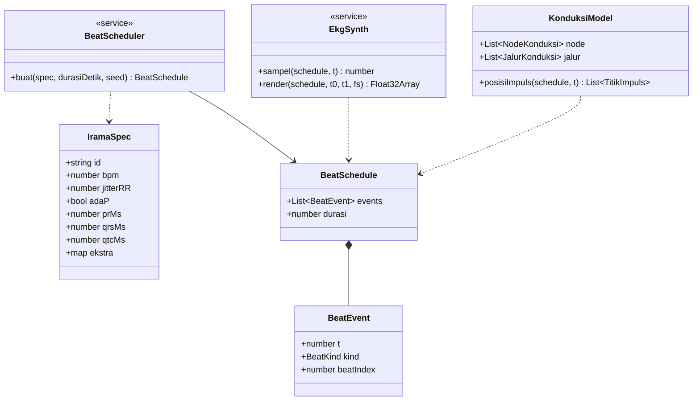

### 9.4 Kontrak tipe inti (`src/engine/types.ts`)
Implementasi **harus** menyerupai ini (nama field identik dengan seed JSON):
```ts
export type Keparahan = 'rendah' | 'sedang' | 'tinggi' | 'darurat';
export type StatusData = 'estimasi' | 'literatur' | 'tervalidasi';
export type Kelompok = 'denyut' | 'gejala' | 'risiko' | 'ekg';
export type Mode = 'awam' | 'lanjutan';
export type Role = 'user' | 'pakar' | 'admin';
export type NilaiBukti = string | boolean;
export type Bukti = Record<string, NilaiBukti>;   // kunci = id variabel; tidak ada kunci = "tidak tahu"

export interface Hipotesis { id: string; urutan: number; nama: string; ringkas: string; deskripsi: string;
  saran: string; keparahan: Keparahan; prior: number; acuan: string[]; }
interface VariabelDasar { id: string; kelompok: Kelompok; pertanyaan: string; bantuan?: string | null; }
export interface VariabelBiner extends VariabelDasar { tipe: 'biner'; pYa: number[]; }          // P(ya|H_i)
export interface VariabelKategori extends VariabelDasar { tipe: 'kategori';
  nilai: { id: string; label: string }[]; p: number[][]; }                                      // p[i][j]=P(nilai_j|H_i)
export type Variabel = VariabelBiner | VariabelKategori;
export interface BasisPengetahuan { versi: string; status: StatusData; catatan: string;
  acuan: Record<string, string>; hipotesis: Hipotesis[]; variabel: Variabel[]; }

export interface LangkahBukti { variabelId: string; pertanyaan: string; nilaiLabel: string; kemungkinan: number[]; }
export interface BarisHasil { id: string; nama: string; prior: number; skor: number; posterior: number; }
export interface HasilInferensi { daftar: BarisHasil[]; langkah: LangkahBukti[]; penyebut: number; }
export interface RedFlag { tingkat: 'darurat' | 'segera' | 'waspada'; judul: string; pesan: string; }
```

### 9.5 Model domain: belajar, kuis, dan gamifikasi
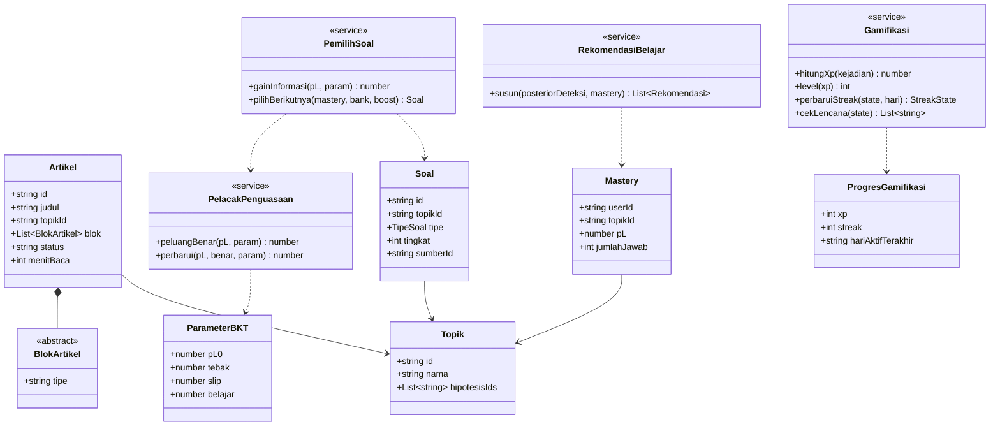
Kontrak tipe (`src/engine/belajar.ts`):
```ts
export type TipeSoal = 'pg' | 'bs' | 'urut' | 'cocok' | 'ekg' | 'hitung' | 'kasus';
export interface Soal {
  id: string; topikId: string; tipe: TipeSoal; tingkat: 1 | 2 | 3;
  pertanyaan: string; ilustrasiId?: string;
  opsi?: { id: string; teks: string }[];
  kunci: string | string[] | number | Record<string, string>;   // pg/bs: id opsi; urut: id berurutan; cocok: pasangan; hitung: angka
  toleransi?: number;                                           // untuk tipe 'hitung'
  penjelasan: string; sumberId: string; status: StatusData;
}
export type BlokArtikel =
  | { tipe: 'judul'; teks: string; level: 2 | 3 }
  | { tipe: 'paragraf'; teks: string }                          // boleh memuat [[istilah:qrs]] (tautan glosarium)
  | { tipe: 'gambar'; ilustrasiId?: string; assetId?: string; alt: string; keterangan?: string }
  | { tipe: 'callout'; gaya: 'info' | 'peringatan' | 'tips'; teks: string }
  | { tipe: 'daftar'; butir: string[]; berurut?: boolean }
  | { tipe: 'interaktif'; widget: 'ekg-slider' | 'konduksi' | 'bayes-slider' | 'nadi-hitung' | 'bandingkan-ekg'; props?: Record<string, unknown> }
  | { tipe: 'cek-paham'; soalId: string }
  | { tipe: 'sumber'; sumberIds: string[] };
export interface ParameterBKT { pL0: number; tebak: number; slip: number; belajar: number }
export interface Mastery { topikId: string; pL: number; jumlahJawab: number; diperbarui: string }
```

## 10. Model data (SQLite)
### 10.1 ERD
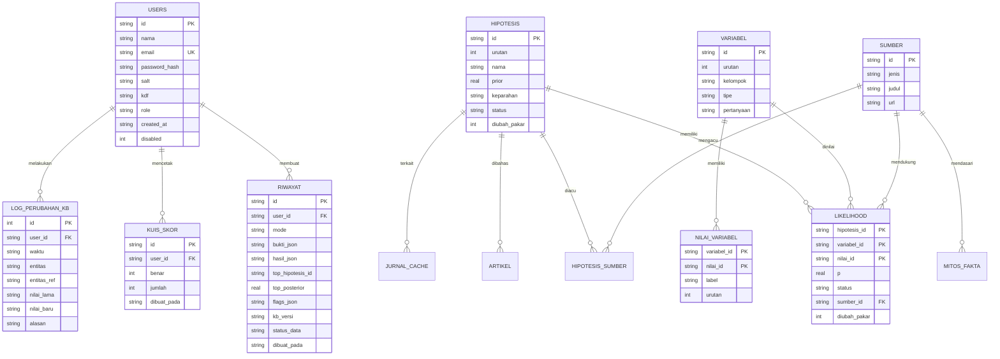

### 10.2 DDL awal (migrasi #1, `PRAGMA user_version = 1`)
```sql
PRAGMA foreign_keys = ON;
CREATE TABLE app_meta (key TEXT PRIMARY KEY, value TEXT NOT NULL);
CREATE TABLE users (
  id TEXT PRIMARY KEY, nama TEXT NOT NULL, email TEXT NOT NULL UNIQUE,
  password_hash TEXT NOT NULL, salt TEXT NOT NULL, kdf TEXT NOT NULL,
  role TEXT NOT NULL CHECK (role IN ('user','pakar','admin')),
  created_at TEXT NOT NULL, last_login_at TEXT, disabled INTEGER NOT NULL DEFAULT 0);
CREATE TABLE sumber (
  id TEXT PRIMARY KEY, jenis TEXT NOT NULL CHECK (jenis IN ('guideline','jurnal','buku','lainnya')),
  judul TEXT NOT NULL, penulis TEXT, tahun INTEGER, url TEXT);
CREATE TABLE kb_versi (
  id INTEGER PRIMARY KEY AUTOINCREMENT, versi TEXT NOT NULL, status TEXT NOT NULL
  CHECK (status IN ('estimasi','literatur','tervalidasi')), catatan TEXT, dibuat_pada TEXT NOT NULL);
CREATE TABLE hipotesis (
  id TEXT PRIMARY KEY, urutan INTEGER NOT NULL, nama TEXT NOT NULL, ringkas TEXT, deskripsi TEXT, saran TEXT,
  keparahan TEXT NOT NULL CHECK (keparahan IN ('rendah','sedang','tinggi','darurat')),
  prior REAL NOT NULL CHECK (prior > 0 AND prior < 1),
  status TEXT NOT NULL DEFAULT 'estimasi' CHECK (status IN ('estimasi','literatur','tervalidasi')),
  diubah_pakar INTEGER NOT NULL DEFAULT 0);
CREATE TABLE hipotesis_sumber (
  hipotesis_id TEXT NOT NULL REFERENCES hipotesis(id) ON DELETE CASCADE,
  sumber_id TEXT NOT NULL REFERENCES sumber(id) ON DELETE CASCADE,
  PRIMARY KEY (hipotesis_id, sumber_id));
CREATE TABLE variabel (
  id TEXT PRIMARY KEY, urutan INTEGER NOT NULL,
  kelompok TEXT NOT NULL CHECK (kelompok IN ('denyut','gejala','risiko','ekg')),
  tipe TEXT NOT NULL CHECK (tipe IN ('biner','kategori')), pertanyaan TEXT NOT NULL, bantuan TEXT);
CREATE TABLE nilai_variabel (
  variabel_id TEXT NOT NULL REFERENCES variabel(id) ON DELETE CASCADE,
  nilai_id TEXT NOT NULL, label TEXT NOT NULL, urutan INTEGER NOT NULL,
  PRIMARY KEY (variabel_id, nilai_id));
CREATE TABLE likelihood (
  hipotesis_id TEXT NOT NULL REFERENCES hipotesis(id) ON DELETE CASCADE,
  variabel_id TEXT NOT NULL, nilai_id TEXT NOT NULL,
  p REAL NOT NULL CHECK (p > 0 AND p < 1),
  status TEXT NOT NULL DEFAULT 'estimasi', sumber_id TEXT REFERENCES sumber(id),
  diubah_pakar INTEGER NOT NULL DEFAULT 0,
  PRIMARY KEY (hipotesis_id, variabel_id, nilai_id),
  FOREIGN KEY (variabel_id, nilai_id) REFERENCES nilai_variabel(variabel_id, nilai_id) ON DELETE CASCADE);
CREATE TABLE log_perubahan_kb (
  id INTEGER PRIMARY KEY AUTOINCREMENT, user_id TEXT REFERENCES users(id), waktu TEXT NOT NULL,
  entitas TEXT NOT NULL, entitas_ref TEXT NOT NULL, nilai_lama TEXT, nilai_baru TEXT, alasan TEXT);
CREATE TABLE riwayat (
  id TEXT PRIMARY KEY, user_id TEXT NOT NULL REFERENCES users(id) ON DELETE CASCADE,
  mode TEXT NOT NULL CHECK (mode IN ('awam','lanjutan')), bukti_json TEXT NOT NULL, hasil_json TEXT NOT NULL,
  top_hipotesis_id TEXT NOT NULL, top_posterior REAL NOT NULL, flags_json TEXT NOT NULL,
  kb_versi TEXT NOT NULL, status_data TEXT NOT NULL, dibuat_pada TEXT NOT NULL);
CREATE INDEX idx_riwayat_user_waktu ON riwayat(user_id, dibuat_pada DESC);
CREATE TABLE kuis_skor (
  id TEXT PRIMARY KEY, user_id TEXT NOT NULL REFERENCES users(id) ON DELETE CASCADE,
  benar INTEGER NOT NULL, jumlah INTEGER NOT NULL, dibuat_pada TEXT NOT NULL);
CREATE TABLE artikel (
  id TEXT PRIMARY KEY, kategori TEXT NOT NULL, judul TEXT NOT NULL, ringkasan TEXT, isi_md TEXT NOT NULL,
  hipotesis_id TEXT REFERENCES hipotesis(id), sumber_id TEXT REFERENCES sumber(id),
  divalidasi INTEGER NOT NULL DEFAULT 0, bawaan INTEGER NOT NULL DEFAULT 1);
CREATE TABLE jurnal_cache (
  pmid TEXT PRIMARY KEY, judul TEXT NOT NULL, penulis TEXT, jurnal TEXT, tahun INTEGER, doi TEXT, url TEXT NOT NULL,
  hipotesis_id TEXT REFERENCES hipotesis(id), diambil_pada TEXT NOT NULL);
CREATE TABLE berita (
  id TEXT PRIMARY KEY, judul TEXT NOT NULL, ringkasan TEXT, sumber_nama TEXT NOT NULL, url TEXT NOT NULL,
  tanggal TEXT, dibuat_oleh TEXT REFERENCES users(id), diambil_pada TEXT);
CREATE TABLE glosarium (istilah TEXT PRIMARY KEY, definisi TEXT NOT NULL, sumber_id TEXT REFERENCES sumber(id));
CREATE TABLE mitos_fakta (
  id TEXT PRIMARY KEY, pernyataan TEXT NOT NULL, adalah_fakta INTEGER NOT NULL, penjelasan TEXT NOT NULL,
  sumber_id TEXT NOT NULL REFERENCES sumber(id));
CREATE TABLE setelan (key TEXT PRIMARY KEY, value TEXT NOT NULL);
```
Aturan data:
- Variabel **biner** disimpan dengan dua nilai (`ya`, `tidak`) di `nilai_variabel` dan dua baris di `likelihood` (p dan 1−p). Editor Pakar hanya mengubah P(ya); P(tidak) otomatis.
- Setiap `(hipotesis, variabel)` kategori: jumlah p semua nilai = 1 (toleransi 1e-9). Validasi di `KbService`.
- `riwayat.bukti_json` menyimpan **jawaban asli** dan `hasil_json` menyimpan `HasilInferensi` (agar detail riwayat bisa dibuka tanpa menghitung ulang, sekaligus menyimpan `kb_versi`).
- Tamu **tidak** menulis ke `riwayat` (hanya memori).

### 10.2b Migrasi #2 (Fase 5): belajar, kuis, gamifikasi
Dijalankan sebagai migrasi bernomor #2 di atas migrasi #1 (jangan ubah migrasi #1). Harus lolos tes migrasi (T-508).
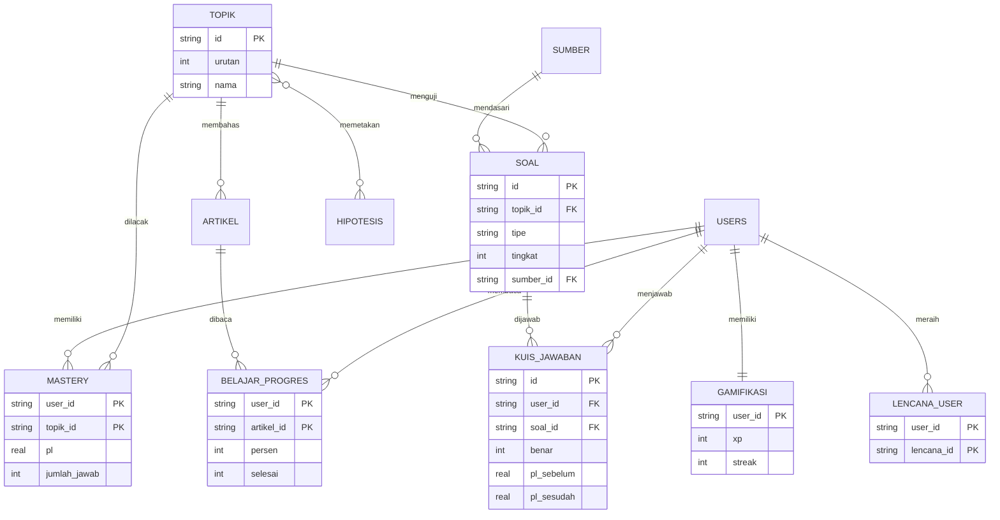
```sql
CREATE TABLE topik (id TEXT PRIMARY KEY, urutan INTEGER NOT NULL, nama TEXT NOT NULL, ringkas TEXT);
CREATE TABLE topik_hipotesis (
  topik_id TEXT NOT NULL REFERENCES topik(id) ON DELETE CASCADE,
  hipotesis_id TEXT NOT NULL REFERENCES hipotesis(id) ON DELETE CASCADE,
  PRIMARY KEY (topik_id, hipotesis_id));
ALTER TABLE artikel ADD COLUMN topik_id TEXT REFERENCES topik(id);
ALTER TABLE artikel ADD COLUMN blok_json TEXT;
ALTER TABLE artikel ADD COLUMN menit_baca INTEGER;
ALTER TABLE artikel ADD COLUMN status TEXT NOT NULL DEFAULT 'draf' CHECK (status IN ('draf','siap'));
CREATE TABLE soal (
  id TEXT PRIMARY KEY, topik_id TEXT NOT NULL REFERENCES topik(id),
  tipe TEXT NOT NULL CHECK (tipe IN ('pg','bs','urut','cocok','ekg','hitung','kasus')),
  tingkat INTEGER NOT NULL CHECK (tingkat BETWEEN 1 AND 3),
  pertanyaan TEXT NOT NULL, ilustrasi_id TEXT, opsi_json TEXT, kunci_json TEXT NOT NULL, toleransi REAL,
  penjelasan TEXT NOT NULL, sumber_id TEXT NOT NULL REFERENCES sumber(id),
  status TEXT NOT NULL DEFAULT 'estimasi', bawaan INTEGER NOT NULL DEFAULT 1);
CREATE TABLE gambar_aset (
  id TEXT PRIMARY KEY, berkas TEXT NOT NULL, alt TEXT NOT NULL, pencipta TEXT NOT NULL,
  sumber_url TEXT NOT NULL, lisensi TEXT NOT NULL CHECK (lisensi IN ('CC0','Public Domain','CC BY 4.0','CC BY 3.0','CC BY 2.5','CC BY 2.0')),
  tanggal_akses TEXT NOT NULL);
CREATE TABLE belajar_progres (
  user_id TEXT NOT NULL REFERENCES users(id) ON DELETE CASCADE,
  artikel_id TEXT NOT NULL REFERENCES artikel(id) ON DELETE CASCADE,
  persen INTEGER NOT NULL DEFAULT 0, selesai INTEGER NOT NULL DEFAULT 0, diperbarui TEXT NOT NULL,
  PRIMARY KEY (user_id, artikel_id));
CREATE TABLE kuis_jawaban (
  id TEXT PRIMARY KEY, user_id TEXT NOT NULL REFERENCES users(id) ON DELETE CASCADE,
  soal_id TEXT NOT NULL REFERENCES soal(id), topik_id TEXT NOT NULL, benar INTEGER NOT NULL, mode TEXT NOT NULL,
  pl_sebelum REAL NOT NULL, pl_sesudah REAL NOT NULL, dibuat_pada TEXT NOT NULL);
CREATE INDEX idx_kuis_jawaban_user ON kuis_jawaban(user_id, dibuat_pada DESC);
CREATE TABLE mastery (
  user_id TEXT NOT NULL REFERENCES users(id) ON DELETE CASCADE,
  topik_id TEXT NOT NULL REFERENCES topik(id),
  pl REAL NOT NULL, jumlah_jawab INTEGER NOT NULL DEFAULT 0, diperbarui TEXT NOT NULL,
  PRIMARY KEY (user_id, topik_id));
CREATE TABLE gamifikasi (
  user_id TEXT PRIMARY KEY REFERENCES users(id) ON DELETE CASCADE,
  xp INTEGER NOT NULL DEFAULT 0, streak INTEGER NOT NULL DEFAULT 0, streak_terpanjang INTEGER NOT NULL DEFAULT 0,
  hari_aktif_terakhir TEXT, pembekuan_minggu TEXT);
CREATE TABLE lencana_user (
  user_id TEXT NOT NULL REFERENCES users(id) ON DELETE CASCADE,
  lencana_id TEXT NOT NULL, diraih_pada TEXT NOT NULL, PRIMARY KEY (user_id, lencana_id));
```
Aturan: `kuis_skor` (migrasi #1) tetap dipakai untuk sesi Kasus pasien virtual; jawaban kuis lain masuk `kuis_jawaban`. Tamu tidak menulis ke tabel mana pun (memori sesi). Hapus akun menghapus semua baris belajar lewat `ON DELETE CASCADE`.

### 10.3 Migrasi dan seeding
- `src/data/migrations.ts` = array migrasi bernomor; dijalankan berurutan dalam transaksi; versi di `PRAGMA user_version`. **Dilarang** mengubah migrasi lama, buat yang baru.
- **Seeding KB:** `seedKbIfNeeded()` membandingkan `app_meta.kb_seed_versi` dengan `versi` pada `docs/kb-seed.v0.1.json` (di-bundle sebagai modul TS/JSON). Bila lebih baru: *upsert* hanya baris dengan `diubah_pakar = 0`, sisipkan baris baru, lalu catat versi di `kb_versi`. Baris `diubah_pakar = 1` **tidak ditimpa**, konflik dilaporkan di Pengaturan > Tentang.
- Seed `sumber` dari `acuan` di JSON. Seed `hipotesis_sumber` dari `hipotesis[].acuan`.
- Seed artikel, glosarium, mitos dari `src/content/*` (T-501).

### 10.4 Penyimpanan non-DB
`expo-secure-store`: `sesi` (`{userId, expiresAt}`). `setelan`: `tema` (`sistem|terang|gelap`), `haptic` (`1|0`), `reduce_motion` (`sistem|1|0`), `gunakan_3d` (`1|0`), `feed_berita_url` (opsional).

---

## 11. Spesifikasi algoritma
### 11.1 Inferensi Bayes (`src/engine/bayes.ts`)
Rumus: **P(Hᵢ | E₁…Eₙ) = P(Hᵢ) · ∏ⱼ P(Eⱼ | Hᵢ) / Σₖ [ P(Hₖ) · ∏ⱼ P(Eⱼ | Hₖ) ]** (asumsi independensi bersyarat, Naive Bayes).
```
infer(kb, bukti):
  prior[i]   = normalisasi(kb.hipotesis[i].prior)
  logSkor[i] = ln(prior[i])
  untuk setiap variabel v (urut KB) yang bukti[v.id] terdefinisi dan valid:
      untuk setiap i: logSkor[i] += ln(max(P(bukti|H_i), EPS))      # EPS = 1e-6
      catat LangkahBukti{ variabelId, nilaiLabel, kemungkinan[] }
  m = max(logSkor);  w[i] = exp(logSkor[i] - m);  posterior[i] = w[i] / sum(w)
  skor[i] = exp(logSkor[i]);  penyebut = sum(skor)
  daftar = urutkan menurun posterior (seri: urutan KB)
```
- Bukti tak terisi **dilewati**. Biner: `true → pYa`, `false → 1 − pYa`. Kategori: ambil `p[i][indeksNilai]`. Nilai tak dikenal diabaikan.
- Tanpa bukti ⇒ posterior = prior. Mode Awam tidak boleh membawa variabel `ekg` (store menghapusnya saat pindah mode).
- Waktu < 20 ms untuk 24 variabel × 12 hipotesis.
- `pendorong(hasil, kb, topId, lawanId)`: untuk tiap langkah, `rasio = P(e|top)/P(e|lawan)`; urut menurun `ln(rasio)` (dipakai layar Kenapa).

### 11.2 Aturan tanda bahaya (IF-THEN, dievaluasi **terpisah** dari Bayes)
| ID | Kondisi | Tingkat | Judul | Pesan |
|---|---|---|---|---|
| R1 | `pingsan=true` DAN (`nyeri_dada=true` ATAU `sesak=true`) | darurat | Pingsan disertai nyeri dada atau sesak | Segera ke IGD atau hubungi 119/112. Jangan berkendara sendiri. |
| R2 | `nyeri_dada=true` DAN `sesak=true` DAN `pusing=true` | darurat | Nyeri dada, sesak, dan pusing bersamaan | Kombinasi ini perlu penanganan segera. Ke IGD atau hubungi 119/112. |
| R3 | `pingsan=true` DAN `bpm='lebih_100'` | darurat | Pingsan dengan denyut sangat cepat | Segera cari pertolongan medis. Ke IGD atau hubungi 119/112. |
| R4 | ada bukti, hipotesis teratas berkeparahan `darurat` (VT) DAN posterior ≥ 0,20 | darurat | Pola menyerupai {nama} | Irama ini berpotensi mengancam nyawa. Segera ke IGD, jangan menunggu. |
| R5 | `pingsan=true` DAN `riwayat_keluarga=true` | segera | Pingsan dengan riwayat keluarga meninggal mendadak | Periksakan ke dokter spesialis jantung sesegera mungkin. |
| R6 | `pingsan=true` (dan R5 tidak berlaku) | segera | Pernah pingsan atau hampir pingsan | Periksakan ke dokter dalam waktu dekat untuk mencari penyebabnya. |
| R7 | ada bukti, hipotesis teratas berkeparahan `tinggi` DAN posterior ≥ 0,50 | waspada | Kemungkinan terbesar: {nama} | Sebaiknya periksa ke dokter dan lakukan EKG dalam waktu dekat. |
Tampilan: urut `darurat > segera > waspada`. `darurat` ⇒ banner merah di atas Hasil + tombol "Hubungi 119/112" (`tel:119`). Aturan tidak boleh dilemahkan (AGENTS §7).

### 11.3 Pertanyaan adaptif (information gain)
Tujuan: memilih variabel belum terjawab yang **paling mengurangi ketidakpastian** posterior.
```
H(p) = - sum_i p_i * log2(p_i)
untuk tiap variabel v belum terjawab (sesuai mode):
    untuk tiap nilai a dari v:
        P(a) = sum_i posterior_i * P(a | H_i)
        posterior'_i(a) = posterior_i * P(a | H_i) / P(a)
    EH(v)   = sum_a P(a) * H(posterior'(a))
    gain(v) = H(posterior) - EH(v)
pilih v dengan gain terbesar (seri: urutan KB)
```
- Berhenti menyarankan bila: posterior teratas ≥ 0,90, ATAU `gain` maksimum < 0,01, ATAU tak ada variabel tersisa. Pengguna selalu bisa menekan "Cukup, lihat hasil".
- Mode adaptif aktif lewat tombol di wizard ("Pertanyaan pintar"). Tampilkan alasan singkat: "Pertanyaan ini paling membantu membedakan {H1} dan {H2}".
- Kompleksitas: O(V·K·H). Waktu < 100 ms.

### 11.4 Bagaimana kalau? (what-if)
Pilih satu variabel terjawab. Untuk setiap nilai alternatif (termasuk "tidak tahu" = hapus bukti), hitung ulang `infer` dan tampilkan tabel: nilai → top 3 + selisih posterior hipotesis teratas awal (pp) + apakah peringkat 1 berubah. Tidak menyimpan apa pun ke riwayat.

### 11.5 Tap Nadi (`src/engine/tapNadi.ts`)
Input: waktu ketukan (ms, monoton). Minimal 8 ketukan, target ±15 detik. Pengguna mengetuk tiap detak.
```
interval[k] = t[k+1] - t[k];   buang interval < 250 ms atau > 2500 ms (ketukan salah)
RR = median(interval);  BPM = 60000 / RR;  bpmKategori: <60 | 60-100 | >100
CV = SD(interval) / mean(interval)
loncat = ada 1-2 interval < 0.8*RR yang diikuti interval > 1.2*RR, dan sisanya CV <= 0.10
ritme: 'teratur' jika CV <= 0.10
       'loncat'  jika loncat
       'tidak_teratur' jika CV > 0.15 (setelah menghapus pasangan loncat)
       selain itu: tidak yakin (tidak mengisi ritme)
```
Keluaran mengisi `bpm` dan `ritme` di wizard (bisa diedit). Wajib tampilkan `TAP_NADI_NOTE`. Tes unit dengan deret sintetis (teratur, loncat, kacau).

### 11.6 Kuis Pasien Virtual (`src/engine/kuis.ts`)
```
buatKasus(kb, rng, mode):
  H* ~ kategorikal(prior)                      # kasus lebih sering = lebih umum
  pilih 6-10 variabel acak (mode awam: tanpa ekg; mode lanjutan: boleh ekg)
  untuk tiap variabel: nilai ~ P(nilai | H*)  # dibangkitkan dari KB (sintetis)
  opsi jawaban = {H*} + 3 distraktor dari hipotesis dengan posterior terbesar selain H*, diacak
  kunci = H*;  pembanding = infer(kb, bukti).daftar[0]
```
Setelah menjawab: tampilkan kunci, hasil Bayes (jika beda dari kunci, beri label "kasus ambigu: bukti belum cukup membedakan"), dan tautan ke Simulasi irama kunci. Skor: +10 benar. 10 soal/sesi. Simpan `kuis_skor` untuk role User ke atas. Wajib `KUIS_NOTE`. RNG ber-seed agar tes stabil.

### 11.7 Ekspor PDF
`expo-print` (HTML→PDF) + `expo-sharing`. Isi: judul, tanggal, nama pengguna, mode, tabel jawaban (pertanyaan → jawaban), top 3 + persentase, tanda bahaya, saran, status data + versi KB, `DISCLAIMER_LONG`, daftar referensi (`hipotesis.acuan` teratas). Tata letak sesuai token DESIGN.md (light). Nama file: `kardiologiku-YYYYMMDD-HHmm.pdf`.

### 11.8 Pelacak penguasaan (Bayesian Knowledge Tracing)
Variabel tersembunyi **L** ∈ {paham, belum paham} untuk tiap (pengguna, topik); `pL` = P(paham). Jawaban benar/salah adalah bukti yang memperbarui `pL` lewat **Teorema Bayes**. Parameter: **tebak** g, **slip** s, **belajar** t, **prior awal** pL0.
```
P(benar)      = pL·(1−s) + (1−pL)·g
pL | benar    = pL·(1−s) / [ pL·(1−s) + (1−pL)·g ]
pL | salah    = pL·s     / [ pL·s     + (1−pL)·(1−g) ]
pL'           = pL|jawab + (1 − pL|jawab)·t          # transisi belajar
```
- Selesai membaca artikel: `pL' = pL + (1−pL)·0,10` (sekali per artikel).
- `pL` dijepit ke [0,01; 0,99]. Awal `pL0 = 0,20`.
- Status penguasaan: **Belum mulai** (belum ada jawaban/artikel), **Mulai** (pL < 0,30), **Belajar** (0,30–0,60), **Hampir** (0,60–0,85), **Dikuasai** (≥ 0,85).

| Tipe soal | tebak g | slip s | belajar t |
|---|---|---|---|
| `pg` (4 opsi) | 0,25 | 0,10 | 0,15 |
| `bs` | 0,50 | 0,10 | 0,15 |
| `urut`, `cocok` | 0,10 | 0,10 | 0,15 |
| `ekg` | 0,25 | 0,15 | 0,15 |
| `hitung` | 0,05 | 0,10 | 0,15 |
| `kasus` | 0,25 | 0,10 | 0,15 |
Semua parameter adalah **estimasi** (konstanta di `src/engine/bkt.ts`); tulis sebagai batasan di laporan.
**Tes emas BKT** (pL = 0,20; g = 0,25; s = 0,10; t = 0,15): jawab benar ⇒ **0,5526**; jawab salah ⇒ **0,1774** (toleransi ±0,0005).

### 11.9 Pemilihan soal adaptif (information gain)
Entropi biner `H(p) = −p·log2 p − (1−p)·log2(1−p)`. Gain informasi tentang L bila satu soal ditanyakan:
```
IG(pL,g,s) = H(pL) − [ P(benar)·H(pL|benar) + P(salah)·H(pL|salah) ]
```
```
pilihBerikutnya(mastery, bank, boostDeteksi):
  untuk tiap topik: skor = IG(pL_topik, g_rata, s) × (1 + 2·boostDeteksi[topik])
                    ×0,5 bila topik itu sudah muncul 2 soal berturut-turut (variasi)
  topik = skor tertinggi (seri: urutan topik)
  tingkat = 1 bila pL<0,40; 2 bila 0,40-0,75; 3 bila >0,75 (jatuh ke tingkat terdekat yang ada)
  soal = belum dijawab dalam 7 hari terakhir (bila habis: yang paling lama tak dijawab)
  tipe `ekg`: bangkitkan baru dari IramaSpec dengan seed
```
IG paling besar di sekitar pL ≈ 0,5 (paling tidak pasti), jadi aplikasi "fokus ke yang paling belum pasti". Tampilkan alasan singkat di UI.

### 11.10 Rekomendasi belajar dari hasil deteksi (Bayes → belajar)
```
bobotDeteksi(topik) = Σ posterior(h) untuk h ∈ hipotesis(topik)        # dari deteksi TERAKHIR (≤ 7 hari), selain itu 0
kebutuhan(topik)    = bobotDeteksi(topik)·(1 − pL_topik) + 0,15·(1 − pL_topik)
```
Rekomendasi = topik urut `kebutuhan` menurun; tampilkan 3 teratas ("Baca tentang ini" = artikel belum selesai + tombol kuis topik). Muncul di layar **Hasil Deteksi** (kartu "Pelajari lebih lanjut") dan hub Belajar. Alasan: "Hasil deteksimu condong ke {nama}, dan topik ini belum kamu kuasai." Persentase diagnosis **tidak** ditampilkan di kartu rekomendasi tanpa disclaimer. Tamu: pakai deteksi sesi berjalan.

### 11.11 Gamifikasi (lembut)
- **XP:** selesai baca artikel +20 (sekali per artikel; syarat: gulir ≥ 90% dan waktu ≥ 50% perkiraan); jawaban benar +10 (pertama kali) / +4 (ulang); jawaban salah +2 (usaha); ujian topik selesai +15; tantangan harian selesai +15; bonus streak +5 × min(streak, 5) pada aktivitas pertama tiap hari (maks +25).
- **Level:** `level(xp) = floor(sqrt(xp / 50)) + 1` (L2 = 50 XP, L3 = 200, L4 = 450, L5 = 800).
- **Streak:** hari aktif bila ≥ 1 artikel selesai ATAU ≥ 5 soal dijawab (waktu lokal). Lewat > 1 hari ⇒ reset ke 1, **kecuali** pembekuan otomatis **1× per pekan ISO** (satu hari kosong dimaafkan). Simpan streak terpanjang.
- **Lencana:** 12 jenis (Lampiran F.4).
- **Prinsip etis:** tanpa leaderboard, tanpa nyawa/penalti, tanpa notifikasi dorong, tanpa hitung mundur yang menekan, teks selalu suportif; gamifikasi tidak boleh mengarahkan keputusan medis; patuhi `reduceMotion`.
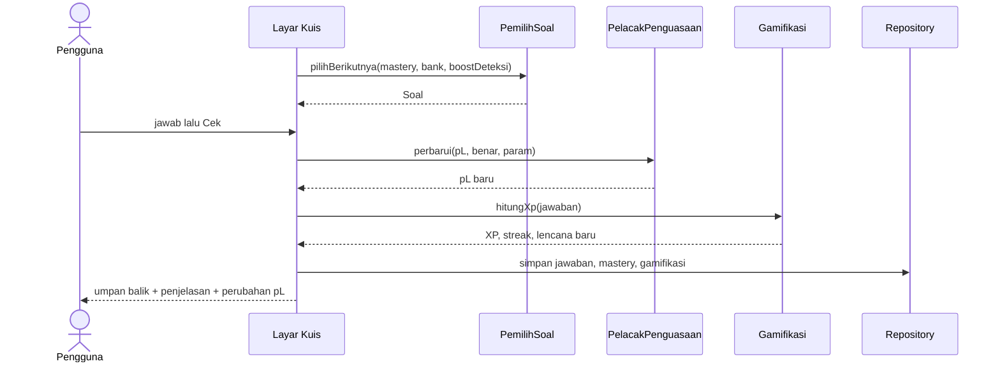

---

## 12. Spesifikasi simulasi
### 12.1 Prinsip: satu jadwal, tiga keluaran
`BeatScheduler.buat(spec, durasi, seed)` menghasilkan **`BeatSchedule`** (daftar `BeatEvent` bertimestamp). **Tiga** konsumen membaca jadwal yang sama: (1) `EkgSynth` menggambar gelombang, (2) `KonduksiModel` menggerakkan impuls di jantung 3D/2D, (3) haptic memicu getar. Karena sumbernya satu, ketiganya **selalu sinkron**.

Jenis event (`BeatKind`): `SA_FIRE`, `ATRIA_START`, `ATRIA_END`, `AV_ENTER`, `AV_EXIT`, `HIS`, `PURKINJE`, `VENT_START`, `VENT_END`, `REPOL_PEAK`, `ECTOPIC_FIRE`, `ACCESSORY_START`, `ACCESSORY_END`, `RETRO_ATRIA`, `BLOCKED`, `FLUTTER_WAVE`, `FIB_WAVELET`.

Waktu normal satu detak (ms dari `ATRIA_START`): `AV_ENTER` 60, `AV_EXIT` 140, `HIS` 150, `PURKINJE` 165, `VENT_START` = PR (160-180), `VENT_END` = PR + QRS (≈ +90), `REPOL_PEAK` = `VENT_START` + 0,65 × QT, dengan **QT = QTc × √RR** (Bazett).

### 12.2 Graf konduksi
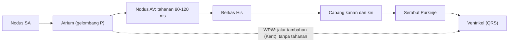
`KonduksiModel` berisi node (`SA, ATRIA_R, ATRIA_L, AV, HIS, BB_R, BB_L, PURKINJE_R, PURKINJE_L, VENT_R, VENT_L, KENT`) dan jalur (kurva 3D `CatmullRomCurve3` + versi 2D). Koordinat final ditetapkan di T-403/T-404, **wajib** mengikuti topologi di atas.

### 12.3 Spesifikasi irama (12)
| id | BPM | Jitter RR | Gelombang P | PR | QRS | QTc | Ciri khas simulasi |
|---|---|---|---|---|---|---|---|
| `normal` | 75 | 2% | ada | 160 | 90 | 400 | Urutan SA→AV→His→Purkinje normal |
| `sinus_takikardia` | 130 | 2% | ada | 140 | 85 | 400 | Sama seperti normal, lebih cepat, QT memendek |
| `sinus_bradikardia` | 48 | 3% | ada | 170 | 90 | 400 | Lebih lambat |
| `fibrilasi_atrium` | 110 | 35% (acak seragam) | tidak ada | – | 90 | 400 | Atrium bergetar (banyak wavelet), garis dasar f-wave 0,03 mV 6-8 Hz, RR tak beraturan |
| `atrial_flutter` | atrium 300; ventrikel 150 (2:1) | 1% | gergaji | – | 90 | 400 | Sirkuit makro-reentri di atrium, gelombang gergaji 0,12 mV, konduksi 2:1 (opsi 4:1) |
| `svt` | 180 | 1% | tersembunyi | – | 85 | 400 | Loop re-entri cepat, QRS sempit |
| `pvc` | 75 + sesekali | 2% | ada (detak normal) | 160 | 90 / PVC 140 | 400 | Detak prematur (60% RR) tanpa P, QRS lebar, T terbalik, lalu jeda kompensasi; peluang 0,2 per detak, tidak dua berturut |
| `vt` | 170 | 2% | tidak ada | – | 160 | – | Fokus ventrikel, QRS lebar mirip sinus, T berlawanan arah |
| `wpw` | 75 | 2% | ada | 100 | 130 | 400 | Jalur Kent: pra-eksitasi, gelombang delta; mode serangan AVRT 190 bpm |
| `long_qt` | 70 | 2% | ada | 160 | 90 | 520 | Repolarisasi diperpanjang, T lebar dan jauh |
| `brugada` | 75 | 2% | ada | 170 | 100 | 410 | Elevasi ST coved di sadapan V1-V2 (satu sadapan representatif) |
| `blok_av` | atrium 90; ventrikel 45 (2:1) | 1% | ada (sebagian tanpa QRS) | 220 | 90 | 400 | Impuls berhenti di nodus AV pada detak terblokir (`BLOCKED`) |
Angka adalah **ilustrasi edukatif**; cocokkan dengan buku/jurnal (T-409) dan catat revisinya.

### 12.4 Sintesis EKG (`ekgSynth.ts`)
Satu detak = jumlah gelombang Gaussian `A·exp(−(t−μ)²/(2σ²))`, dengan `t` relatif terhadap puncak R (detik):
| Gelombang | A (mV) | μ (s) | σ (s) |
|---|---|---|---|
| P | +0,15 | −0,20 | 0,025 |
| Q | −0,10 | −0,025 | 0,010 |
| R | +1,00 | 0 | 0,012 |
| S | −0,25 | +0,025 | 0,010 |
| T | +0,30 | +0,25 (dari QT) | 0,045 |
Modifikasi per irama: **WPW**: tambah gelombang delta (A 0,15, μ −0,05, σ 0,03), PR pendek, σ QRS lebih lebar. **PVC**: tanpa P, σ_R 0,025, T −0,35. **VT**: σ_R 0,045, T berlawanan. **Brugada**: tambah elevasi J (A 0,35, μ +0,06, σ 0,05) dan T negatif −0,2. **Long QT**: μ_T digeser sesuai QT, σ_T 0,06. **AF**: hapus P, tambah f-wave sinus 6-8 Hz (0,03 mV). **Flutter**: tambah gigi gergaji periode 0,2 s. **Blok AV**: P tanpa QRS pada detak `BLOCKED`.
- Frekuensi sampel render 250 Hz. Fungsi **murni dan deterministik** (seed).
- Strip digambar sesuai DESIGN.md §10 (25 mm/s, 10 mm/mV).

### 12.5 Mode khusus
- **WPW:** impuls dari SA pecah di atrium. Jalur A lewat nodus AV (redup/tertahan), jalur B lewat **Kent** menuju ventrikel dan memulai aktivasi dini dari satu titik (menjalar lambat = delta), lalu bertemu gelombang His-Purkinje (fusion). EKG: PR pendek, delta, QRS lebar.
- **SVT re-entri (AVRT):** impuls turun lewat nodus AV → His → ventrikel → naik lewat Kent → atrium → nodus AV lagi (loop ~330 ms ≈ 180 bpm). EKG: takikardia teratur, QRS sempit.
- **AF:** banyak wavelet acak di atrium, nodus AV meneruskan tak teratur. **Flutter:** loop makro di atrium kanan. **PVC/VT:** fokus ektopik (`ectopic`) di ventrikel. **Blok AV 2:1:** impuls berhenti di nodus AV pada detak ganjil/genap.

### 12.6 State pemutar simulasi
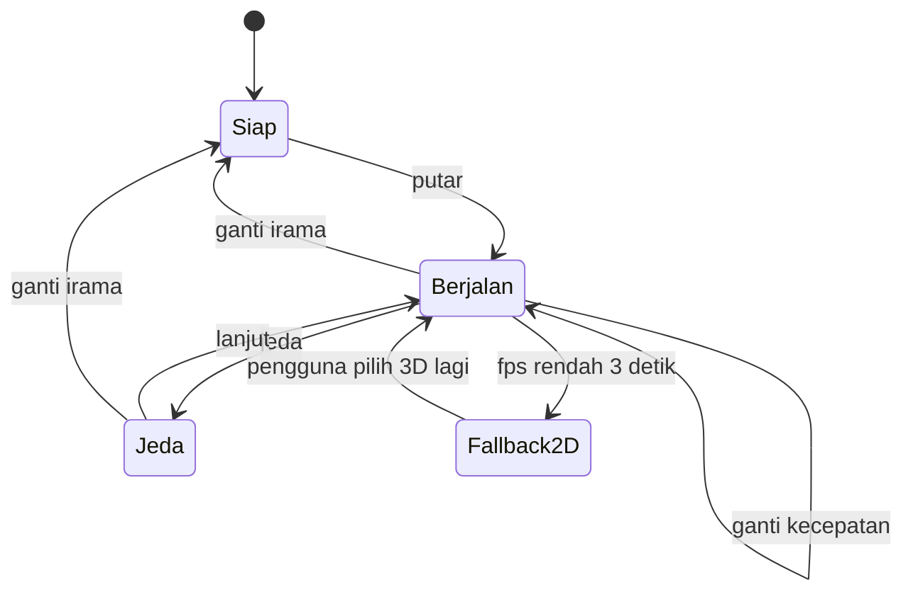
Kontrol: putar/jeda, kecepatan 0,25x/0,5x/1x, langkah per detak, toggle label (P, QRS, T, PR, QT), caliper, reset kamera, toggle haptic. Panel "Apa yang terjadi?" (teks dari `hipotesis.deskripsi` + keterangan simulasi). Selalu tampilkan `SIMULASI_NOTE`.

---

## 13. Spesifikasi layar
Visual mengikuti `DESIGN.md` §6-§7. Kolom "Kosong/Galat" wajib diimplementasikan.
| Rute | Tujuan | Data | Aksi utama | Kosong / Galat |
|---|---|---|---|---|
| `(setup)/setup-admin` | Membuat admin pertama | – | Isi nama, email, sandi (≥ 8) | Validasi inline; tidak bisa dilewati |
| `(onboarding)` | Menjelaskan app + persetujuan | – | Centang paham, lanjut | Tombol nonaktif sampai dicentang |
| `(auth)/login`, `daftar` | Masuk/daftar/tamu | `users` | Login, Daftar, Masuk sebagai Tamu | Pesan galat umum ("email atau kata sandi salah"), tunda setelah 5 gagal |
| `(tabs)/index` Beranda | Pintu masuk | riwayat terakhir | Mulai Deteksi, Simulasi, Kuis, Tap Nadi, Darurat | Tanpa riwayat: kartu ajakan |
| `(tabs)/deteksi` | Wizard | `bukti`, KB | Jawab, ganti mode, Cukup lihat hasil | Belum ada jawaban: pesan "isi minimal satu data" |
| `hasil` | Menampilkan hasil | `HasilInferensi`, `RedFlag[]` | Kenapa, What-if, Simulasi, PDF, Ulangi | Tanpa bukti: arahkan kembali ke wizard |
| `kenapa` | Penjelasan Bayes | `HasilInferensi` | Gulir, bagikan | – |
| `whatif` | Skenario ganti jawaban | `bukti` | Pilih variabel & nilai | Tak ada jawaban: pesan |
| `tap-nadi` | Ukur BPM/ritme | ketukan | Ketuk, ulangi, pakai hasil | < 8 ketukan: minta ulang |
| `(tabs)/simulasi` | Daftar irama | `rhythms` | Pilih irama | – |
| `simulasi/[irama]` | Pemutar | `BeatSchedule` | Kontrol §12.6 | Fallback 2D otomatis |
| `(tabs)/edukasi` | Hub Belajar, Artikel, Kuis, Referensi | artikel, soal, penguasaan, gamifikasi, jurnal/berita | Rekomendasi, baca, kuis, buka referensi | Offline: tampilkan cache + info; kosong: ajakan |
| `edukasi/artikel/[id]` | Pembaca artikel interaktif | `Artikel`, `BlokArtikel[]` | Baca, widget, cek-paham, tandai selesai | Artikel `draf`: badge; blok gagal: lewati + catat |
| `edukasi/peta` | Peta Belajar dan lencana | `mastery`, `lencana_user` | Buka topik | Tamu: ajakan daftar |
| `kuis/[mode]` | Sesi kuis (5 mode) | `Soal`, `mastery` | Jawab, cek, lanjut, ringkasan | Bank kosong untuk topik: pilih topik lain |
| `(tabs)/profil` | Akun & pengaturan | `users`, `setelan` | Riwayat, ganti sandi, tema, hapus data, keluar | Tamu: ajakan daftar |
| `riwayat/index`, `[id]` | Daftar & detail | `riwayat` | Buka, hapus | Kosong: EmptyState |
| `pakar/*` | Editor KB | KB | Ubah angka, status, sumber | Validasi p; alasan wajib |
| `admin/pengguna` | Kelola akun | `users` | Ubah role/nonaktif/hapus | Cegah admin terakhir dihapus |
| `pengaturan`, `tentang` | Pengaturan; sumber & lisensi | `setelan`, KB | Ubah; lihat status data & acuan | – |

### 13.1 State wizard
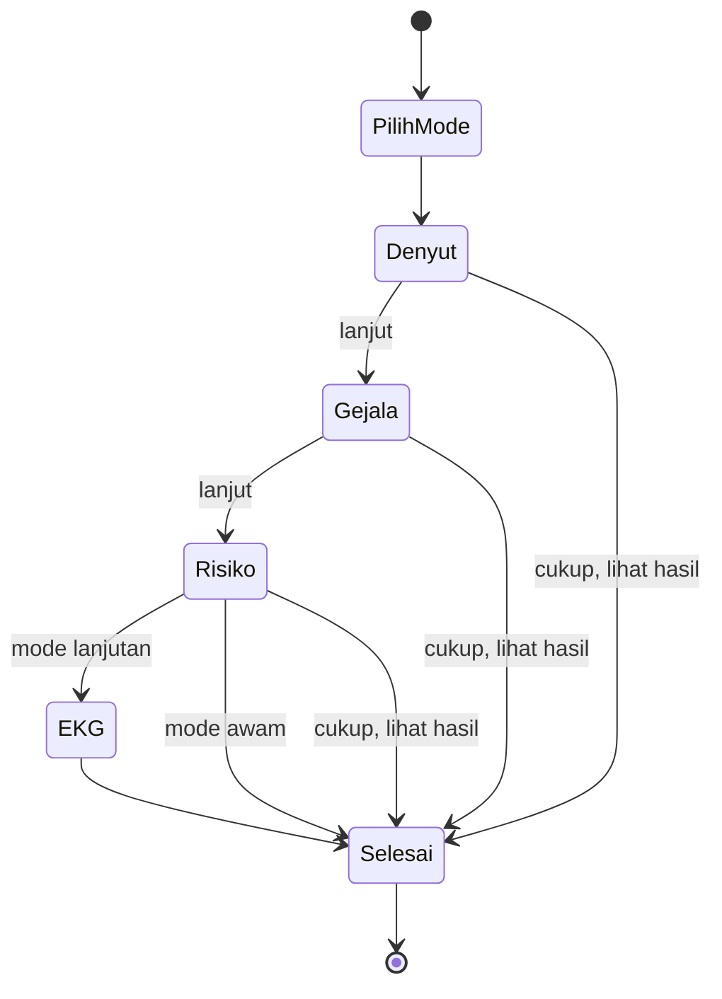

## 14. Spesifikasi Edukasi, Artikel Interaktif, dan Kuis
- **Segmen:** lihat §14.1 (Belajar, Artikel, Kuis, Referensi). Pencarian teks + filter per topik.
- **Artikel:** lihat §14.2. Klaim medis wajib punya `sumber_id`. Badge "Divalidasi pakar" hanya bila `divalidasi = 1`.
- **Jurnal (PubMed E-utilities, tanpa kunci API):**
  - `GET https://eutils.ncbi.nlm.nih.gov/entrez/eutils/esearch.fcgi?db=pubmed&retmode=json&retmax=10&sort=relevance&term=<query>` lalu `esummary.fcgi?db=pubmed&retmode=json&id=<pmid,pmid,...>`.
  - Query per hipotesis: `"<kata kunci>"[Title] AND review[pt]`. Kata kunci: `sinus tachycardia`, `sinus bradycardia`, `atrial fibrillation`, `atrial flutter`, `supraventricular tachycardia`, `premature ventricular contraction`, `ventricular tachycardia`, `Wolff-Parkinson-White syndrome`, `long QT syndrome`, `Brugada syndrome`, `atrioventricular block`; `normal` memakai `cardiac arrhythmia`.
  - Tampilkan **judul, penulis, jurnal, tahun, tautan** `https://pubmed.ncbi.nlm.nih.gov/<pmid>/`. **Tanpa abstrak** (DEC-13).
  - Batas ≤ 3 permintaan/detik. Cache `jurnal_cache` 7 hari. Offline ⇒ tampilkan cache + label "data tersimpan".
- **Berita:** daftar tautan yang ditambah Pakar/Admin (judul, ringkasan ≤ 200 karakter, sumber, URL, tanggal). Opsional `feed_berita_url` (JSON array dengan skema sama). Selalu tampilkan nama sumber + tanggal. Seed kosong (DEC-12).
- **Mitos & Fakta:** kartu swipe; setiap item wajib `sumber_id`. **Glosarium:** ≥ 20 istilah (P, QRS, T, PR, QT/QTc, RR, BPM, nodus SA, nodus AV, His, Purkinje, depolarisasi, repolarisasi, atrium, ventrikel, takikardia, bradikardia, aritmia, EKG, prior, likelihood, posterior).
- **Offline:** semua konten bawaan selalu tersedia; konten jaringan tersimpan di SQLite setelah pernah dibuka.

### 14.1 Hub Belajar (tab Edukasi)
Segmen: **Belajar** | **Artikel** | **Kuis** | **Referensi**.
- **Belajar (hub):** sapaan, kartu XP/level/streak, "Rekomendasi untukmu" (§11.10), "Lanjutkan membaca", "Kuis hari ini", dan **Peta Belajar** (14 simpul, warna menurut status penguasaan, semua terbuka).
- **Artikel:** daftar + cari + filter topik. **Kuis:** pilih mode (§14.4). **Referensi:** Jurnal (PubMed), Berita, Mitos & Fakta, Glosarium.

### 14.2 Artikel interaktif
Model blok (§9.5). Pembaca artikel: bilah progres baca, perkiraan menit, glosarium inline `[[istilah:qrs]]` (ketuk ⇒ bottom sheet definisi), gambar berketerangan, callout, widget interaktif, dan `cek-paham` inline. Akhir artikel: "Tandai selesai" (+XP) dan "Kuis topik ini". Gambar wajib punya `alt`.
**Widget:** `ekg-slider` (pilih irama/geser BPM ⇒ `EkgStrip` hidup), `konduksi` (`HeartView2D`, toggle normal/WPW), `bayes-slider` (dua hipotesis; geser prior dan likelihood ⇒ bar posterior + rumus berjalan), `nadi-hitung` (mini Tap Nadi), `bandingkan-ekg` (geser untuk membandingkan dua irama).
**Artikel seed (≥ 16):** 12 aritmia (satu per hipotesis) + (a) Sistem konduksi jantung dan cara membaca EKG, (b) Mengenal Teorema Bayes lewat Kardiologiku, (c) Gaya hidup sehat untuk jantung, (d) Tanda bahaya: kapan ke IGD. Isi dibuat dari KB/glosarium + sumber tercatat; tiap artikel punya ≥ 1 gambar dan 1-3 `cek-paham`. Artikel `status = 'draf'` tampil dengan badge "Draf, belum divalidasi"; hanya `siap` tanpa badge.

### 14.3 Gambar
1. **Ilustrasi kode** (`ilustrasiId`): komponen React sesuai token DESIGN. Daftar di Lampiran F.5 (`il_konduksi`, `il_gelombang_pqrst`, `il_ekg_<irama>` × 12 strip statis dari `ekgSynth`, `il_bpm_kategori`, `il_bayes_alur`, `il_nadi_cara`).
2. **Gambar berlisensi** (`assetId` ⇒ `gambar_aset`): maksimal 12; lisensi hanya **CC0, Public Domain, CC BY** (CC BY menuntut atribusi). **Dilarang** NC, ND, SA, dan gambar stok berbayar/"bebas pakai" non-CC. Berkas WebP ≤ 150 KB, lebar 1080. Catat di `docs/ATTRIBUTION.md` (judul, pencipta, URL sumber, lisensi + versi, tanggal akses) dan tampilkan atribusi di bawah gambar ("{judul} oleh {pencipta}, {lisensi}"). Sumber disarankan: Wikimedia Commons, NIAID BioArt, Wellcome Collection (Public Domain Mark), Openverse. **Bila lisensi tidak bisa diverifikasi ⇒ jangan dipakai**, pakai ilustrasi kode. Gambar berlisensi hanya untuk konteks, bukan pendukung klaim klinis.

### 14.4 Kuis
**Tipe soal:** `pg`, `bs`, `urut` (susun urutan), `cocok` (pasangkan), `ekg` (baca strip sintetis), `hitung` (angka dengan toleransi), `kasus` (pasien virtual §11.6).
**Mode:** *Latihan adaptif* (default, §11.9), *Ujian topik* (10 soal satu topik), *Baca EKG* (10 soal `ekg`), *Kasus pasien virtual*, *Tantangan harian* (5 soal dari rekomendasi).
**Alur per soal:** tampil ⇒ pilih ⇒ Cek ⇒ umpan balik (benar/salah, penjelasan, sumber, tautan "Baca artikel terkait", perubahan `pL` dengan hitung-naik) ⇒ lanjut. **Ringkasan sesi:** skor, XP, lencana baru, perubahan penguasaan per topik, rekomendasi bacaan.
**Soal `ekg`** dibangkitkan dari `IramaSpec` (seed RNG) ⇒ pasokan tak terbatas; opsi pengecoh dipilih dari irama paling mirip (mis. AF vs flutter).
**Bank soal:** ≥ 70 soal bawaan (≥ 5 per topik, campur tipe dan tingkat). Tiap soal **wajib** `sumber_id` + `penjelasan`; soal tanpa sumber dilarang. Pakar/Admin dapat menambah/mengubah soal (T-506).

### 14.5 Mode Tamu dan privasi belajar
Tamu: progres, penguasaan, XP hanya di memori sesi (dengan ajakan daftar). User+: tersimpan lokal (SQLite). Hapus akun menghapus semua data belajar.

## 15. Persyaratan non-fungsional
| Kategori | Persyaratan |
|---|---|
| Performa | Cold start < 3 dtk (tanpa font eksternal lambat); inferensi < 20 ms; adaptif < 100 ms; simulasi 60fps (min 30fps); gulir daftar tanpa jank |
| Offline | 100% fitur kecuali PubMed/feed; data bawaan selalu tersedia |
| Keamanan | §6.4; tak ada rahasia di kode; SQL parameterized; validasi zod |
| Privasi | Data kesehatan hanya di perangkat; tanpa analitik; hapus akun menghapus semua data pengguna; ekspor PDF atas inisiatif pengguna |
| Aksesibilitas | DESIGN §13 |
| Lokalisasi | Bahasa Indonesia; format angka/tanggal Indonesia |
| Kompatibilitas | Android 8+ dan iOS 15+ (atau minimum SDK Expo terpilih); layar 360-430dp |
| Pemeliharaan | Engine/sim murni dan teruji; migrasi bernomor; seed berversi |
| Kualitas kode | TS strict, lint bersih, cakupan tes engine+sim ≥ 80% baris |

---

## 16. Rencana fase dan task
### 16.0 Definition of Done global (berlaku untuk **setiap** task, selain DoD khusus)
- [ ] `npm run typecheck`, `npm run lint`, `npm test` hijau.
- [ ] Tidak ada hex/magic number visual di komponen (pakai token). Teks UI dari `strings.ts`.
- [ ] Disclaimer/banner wajib muncul di layar yang disyaratkan (AGENTS §7).
- [ ] Komponen interaktif punya `accessibilityLabel` dan target ≥ 48dp.
- [ ] 12 kasus emas tetap hijau.
- [ ] `docs/PROGRESS.md` diperbarui; keputusan baru dicatat di `docs/DECISIONS.md`.

Urutan fase: **0 → 1 → 2 → 3 → 4 → 5 → 6**. Fase 4 boleh dimulai setelah Fase 1 jika Fase 2-3 tertunda (engine sim tidak bergantung auth), tetapi tetap urut ID di dalam fase.

### FASE 0: Setup dan fondasi
**T-001 — Inisialisasi proyek** · Dep: – · Output: repo, config, `docs/`
- Isi: `create-expo-app`, bersihkan template, struktur folder (AGENTS §5), TS strict, eslint+prettier, vitest, script npm, salin `docs/`.
- [ ] Aplikasi tampil di Expo Go (layar "Kardiologiku"). [ ] 3 perintah hijau. [ ] `PROGRESS.md` berisi seluruh task (belum dicentang).

**T-002 — Tema, NativeWind, dan UI kit** · Dep: T-001 · Output: `src/ui/theme.ts`, `src/ui/themeVars.ts`, `tailwind.config.js`, `global.css`, `scripts/cek-kelas.ts`, `src/ui/components/*`
- Isi: pasang NativeWind v4 (DESIGN §15), `theme.ts` = **satu-satunya sumber** hex (light/dark), `themeVars.ts` menurunkan variabel RGB dari `theme.ts`, muat font (Fraunces, Instrument Sans, JetBrains Mono), komponen DESIGN §6 (Button, Chip, TriToggle, ProbBar, Card, Banner, SeverityBadge, StatTile, Stepper, SectionTitle, EmptyState, Dialog, Toast) ditulis dengan kelas Tailwind bertoken. Skrip `cek-kelas` (npm script `cek:kelas`) gagal bila ada kelas terlarang (DESIGN §15.4).
- [ ] Layar galeri `/dev/galeri` (hanya mode dev) menampilkan semua komponen dan state di light+dark, memakai pengaturan tema Sistem/Terang/Gelap. [ ] `tailwind.config.js` **tidak** memuat palet bawaan Tailwind. [ ] `npm run cek:kelas` hijau (dan gagal pada contoh kelas terlarang di tes). [ ] Tes: setiap token ada di light dan dark; hex hanya ada di `theme.ts`. [ ] Tes render ProbBar (lebar sesuai nilai, label a11y).

**T-003 — Skeleton navigasi** · Dep: T-002 · Output: `app/**` placeholder
- Isi: semua rute §6.2 sebagai placeholder, tab 5 sesuai DESIGN, gerbang `app/index.tsx` (stub).
- [ ] Setiap rute terbuka tanpa crash. [ ] Tab bar sesuai DESIGN §6.

**T-004 — Tipe dan utilitas** · Dep: T-001 · Output: `types.ts`, `rng.ts`, `format.ts`, `rbac.ts`, `strings.ts`
- Isi: kontrak §9.4, RNG ber-seed (mulberry32), format persen `81,9%` / tanggal / ms, `rbac.can(role, kemampuan)`, string kanonik DESIGN §12. Acuan tipe: `docs/reference/engine/types.ts`.
- [ ] Tes `format`, `rng` (deterministik), `rbac`. [ ] String kanonik identik dengan DESIGN §12.

**T-005 — Motion kit** · Dep: T-002 · Output: `src/ui/motion.ts`, `src/ui/components/{TraceDraw,CountUp,PressScale,Stagger}.tsx`
- Isi: katalog gerak DESIGN §16 sebagai preset (`motion.ts`: durasi, easing, pegas) dan komponen pembungkus (tulis-jejak, hitung-naik angka, tekan-skala + haptic, masuk berurutan). Pakai Reanimated 4 sesuai DEC-19.
- [ ] Galeri menampilkan tiap gerak. [ ] `reduceMotion` sistem/pengaturan menggantikan semua gerak dengan fade ≤ 120 ms (angka langsung tampil, jejak statis). [ ] Tes unit untuk `motion.ts` (durasi ≤ 400 ms) dan logika count-up (nilai akhir tepat). [ ] Maksimal 2 animasi bersamaan di luar simulasi.

**T-006 — Logo, splash, dan ikon aplikasi** · Dep: T-002, T-005 · Output: `src/ui/Logo.tsx`, splash animasi, `assets/icon.png`, adaptive icon, `docs/ATTRIBUTION.md`
- Isi: komponen `Logo` varian `mark` (vektor dari `docs/assets/logo/*.svg`: terang/gelap/mono) dan `hero` (jantung realistis berlisensi + jejak EKG animasi Skia, DESIGN §17). Splash sesuai DESIGN §17.5. Ikon aplikasi dari `docs/assets/logo/icon-1024.png` dan `icon-foreground-1024.png` (`app.json`: icon, adaptive icon, monochrome). **Jantung realistis:** pilih satu kandidat di `docs/ATTRIBUTION.md` (CC0/Public Domain/CC BY), verifikasi lisensi di halaman berkas, unduh versi tanpa label dan berlatar transparan (hapus latar bila perlu), simpan WebP ≤ 150 KB di `assets/logo/jantung-realistis.webp`, isi atribusi. **Bila tidak bisa mengunduh/memverifikasi: berhenti di bagian itu, pakai varian `mark` sebagai logo utama, dan laporkan ke pemilik** (pemilik bisa meletakkan berkas sendiri).
- [ ] `Logo` tampil di terang/gelap/mono pada ukuran 24, 72, dan hero. [ ] Splash ≤ 1,6 s dan statis saat `reduceMotion`. [ ] Ikon aplikasi dan adaptive icon terpasang di `app.json`. [ ] `ATTRIBUTION.md` memuat sumber, pencipta, lisensi (+versi), URL, tanggal akses; atribusi tampil di Tentang. [ ] Tidak ada gambar tanpa lisensi terverifikasi.

### FASE 1: Deteksi inti (offline, tanpa akun)
**T-101 — Modul seed KB + validator** · Dep: T-004 · Output: `src/knowledge/seed.ts`, `validate.ts`
- Isi: muat `kb-seed.v0.1.json` (typed), skema zod, `validasiBasisPengetahuan`.
- [ ] Validator mengembalikan `[]` untuk seed. [ ] Tes: 12 hipotesis, 24 variabel, panjang array = 12, jumlah prior = 1, baris kategori = 1. [ ] Tes negatif (data rusak ditolak).

**T-102 — SQLite, migrasi, seeding** · Dep: T-101 · Output: `src/data/db.ts`, `migrations.ts`, `seed.ts`
- Isi: DDL §10.2 sebagai migrasi #1, `seedKbIfNeeded()` (aturan §10.3), antarmuka `SqlExecutor` agar bisa dites di Node.
- [ ] Peluncuran pertama membuat DB lengkap (12/24/likelihood). [ ] Menjalankan ulang tidak menggandakan data. [ ] `kb_versi` tercatat. [ ] Tes migrasi + seeding (adapter in-memory).

**T-103 — Repository** · Dep: T-102 · Output: `src/data/repositories/*`
- Isi: `KbRepository.muat()` (rakit `BasisPengetahuan`), `SetelanRepository`, antarmuka `RiwayatRepository`/`UserRepository` (implementasi menyusul).
- [ ] `muat()` deep-equal dengan seed (tes). [ ] Setelan baca/tulis lolos tes.

**T-104 — Mesin inferensi Bayes** · Dep: T-004, T-101 · Output: `src/engine/bayes.ts` + tes
- Isi: §11.1 (`infer`, `pendorong`, `normalisasi`, `kemungkinanBukti`). **Implementasi acuan** (sudah lulus 12 kasus emas): `docs/reference/engine/bayes.ts` + `__tests__/bayes.test.ts`; boleh dijadikan titik awal.
- [ ] 12 kasus emas hijau (Lampiran B, toleransi ±0,1 pp). [ ] Tanpa bukti = prior. [ ] Σ posterior = 1 (1e-12). [ ] Bukti tak dikenal diabaikan. [ ] Benchmark < 20 ms.

**T-105 — Evaluator red flag** · Dep: T-104 · Output: `src/engine/redflag.ts` + tes
- Isi: §11.2 (R1-R7). **Implementasi acuan:** `docs/reference/engine/redflag.ts` + `__tests__/redflag.test.ts`.
- [ ] Tes tiap aturan + kombinasi + urutan tingkat. [ ] Tanpa bukti ⇒ `[]`.

**T-106 — Store deteksi + DeteksiService** · Dep: T-103, T-104, T-105 · Output: `src/store/deteksi.ts`, `src/services/deteksi.ts`
- Isi: `mode, langkah, bukti, setBukti, setMode (hapus bukti ekg saat awam), reset`; `hitung(bukti)` memanggil engine + red flag; hasil memoized.
- [ ] Tes store (pindah ke awam menghapus bukti ekg). [ ] Hasil otomatis diperbarui saat bukti berubah.

**T-107 — Wizard Deteksi** · Dep: T-002, T-106 · Output: `app/(tabs)/deteksi.tsx`
- Isi: pilih mode, 3-4 langkah, TriToggle/Chip, Stepper, "Cukup, lihat hasil", validasi min 1 jawaban.
- [ ] Sesuai wireframe DESIGN §7. [ ] Seluruh 24 variabel bisa diisi. [ ] "Tidak tahu" menghapus bukti. [ ] Bisa dipakai dengan pembaca layar.

**T-108 — Panel probabilitas live** · Dep: T-107 · Output: komponen `PeluangLive`
- Isi: top 3 dengan ProbBar animasi di bawah wizard, bisa dilipat.
- [ ] Pembaruan < 100 ms setelah jawaban. [ ] Tidak ada jank saat mengetik/mengetuk cepat.

**T-109 — Layar Hasil** · Dep: T-105, T-106, T-002 · Output: `app/hasil.tsx`
- Isi: banner red flag, hero top-1 (`numHero`), top 3 + "Lihat semua 12", saran, SeverityBadge, banner data estimasi, disclaimer, tombol (Kenapa aktif; What-if/Simulasi/PDF nonaktif berlabel "segera" sampai tasknya selesai).
- [ ] Sesuai wireframe. [ ] Tombol Darurat membuka `tel:119`. [ ] Dialog peringatan saat R1-R4. [ ] Tanpa bukti ⇒ kembali ke wizard.

**T-110 — Layar "Kenapa hasilnya begini?"** · Dep: T-109 · Output: `app/kenapa.tsx`
- Isi: 5 bagian (rumus, prior, bukti→kecocokan per langkah untuk top 3, perkalian + normalisasi, pendorong + dan −).
- [ ] Semua angka identik dengan `HasilInferensi`. [ ] Notasi ilmiah untuk skor sangat kecil. [ ] Tetap terbaca di font 1.3x.

**T-111 — Onboarding, Beranda, Pengaturan dasar, Tentang** · Dep: T-002, T-003 · Output: layar terkait
- Isi: onboarding **interaktif** 3 slide + persetujuan (DESIGN §18.1, logo dari T-006), Beranda (header berlogo, strip EKG hero statis dulu, tombol Darurat), Pengaturan (tema, haptic, reduce motion), Tentang & Sumber (status data, versi KB, daftar acuan, disclaimer panjang, atribusi gambar).
- [ ] Persetujuan wajib sebelum masuk. [ ] Banner data estimasi tampil. [ ] Tema sistem/terang/gelap bekerja.

### FASE 2: Auth dan role (lokal)
**T-201 — Setup Admin dan gerbang sesi** · Dep: T-103, T-111 · Output: `(setup)/setup-admin`, `app/index.tsx`
- Isi: bila `users` kosong ⇒ Setup Admin; selain itu cek sesi (§7.1).
- [ ] Alur sesuai peta navigasi. [ ] Setup Admin tidak bisa dilewati.

**T-202 — AuthService + UserRepository + hashing** · Dep: T-103 · Output: `src/services/auth.ts`, `src/data/repositories/user.ts`
- Isi: PBKDF2 (§6.4), `daftar/login/logout/sesiAktif/setupAdmin`, pembatasan percobaan.
- [ ] Tes hash/verify. [ ] Tidak ada plaintext di DB (tes memeriksa kolom). [ ] Salt unik per user. [ ] 5 gagal ⇒ tunda 30 dtk.

**T-203 — UI Login/Daftar/Tamu/Logout** · Dep: T-201, T-202, T-006 · Output: `(auth)/*`
- Isi: alur §7.4, validasi zod (email, sandi ≥ 8), sesi `SecureStore`, dan interaksi DESIGN §18.2 (jejak bereaksi, validasi inline, tampil/sembunyi sandi, meter kekuatan, haptic galat, keyboard-avoiding).
- [ ] Sesi bertahan setelah restart. [ ] Mode Tamu masuk tanpa akun. [ ] Pesan galat tidak membocorkan email mana yang ada. [ ] Interaksi DESIGN §18.2 ada dan mematuhi `reduceMotion`.

**T-204 — RBAC** · Dep: T-004, T-203 · Output: `src/lib/rbac.ts`, `<RequireRole>`, guard rute
- Isi: matriks §4.1 di kode; sembunyikan menu; tolak akses langsung ke rute terlarang.
- [ ] Tes matriks (tiap role × kemampuan). [ ] Rute `pakar/*` dan `admin/*` redirect bila tak berhak.

**T-205 — Riwayat** · Dep: T-109, T-203 · Output: `RiwayatRepository`, `riwayat/*`
- Isi: simpan otomatis di Hasil (User+), daftar, detail (dari `hasil_json`), hapus. Tamu: memori saja + catatan.
- [ ] Tes repository. [ ] Detail identik dengan hasil saat disimpan (tampilkan `kb_versi`). [ ] Tamu tidak menulis DB.

**T-206 — Profil** · Dep: T-203, T-205 · Output: `(tabs)/profil.tsx`
- Isi: akun, ganti sandi, hapus akun (cascade), pintasan riwayat, pengaturan, keluar.
- [ ] Ganti sandi memverifikasi sandi lama. [ ] Hapus akun menghapus riwayat dan skor. [ ] Tamu melihat ajakan daftar.

**T-207 — Kelola pengguna (admin)** · Dep: T-204 · Output: `admin/pengguna.tsx`
- Isi: daftar, ubah role, nonaktifkan, hapus.
- [ ] Tidak bisa menurunkan/menghapus admin terakhir (tes). [ ] Akun nonaktif tidak bisa login.

### FASE 3: Deteksi pintar
**T-301 — Pertanyaan adaptif** · Dep: T-104, T-107 · Output: `src/engine/adaptif.ts`, tombol "Pertanyaan pintar"
- Isi: §11.3 + UI alasan singkat.
- [ ] Tes: gain ≥ 0; memilih variabel informatif pada kasus uji; kondisi berhenti benar. [ ] < 100 ms.

**T-302 — Bagaimana kalau?** · Dep: T-104, T-109 · Output: `src/engine/whatif.ts`, `app/whatif.tsx`
- Isi: §11.4.
- [ ] Tes: hasil sama dengan `infer` manual. [ ] Tidak menulis riwayat.

**T-303 — Tap Nadi** · Dep: T-107 · Output: `src/engine/tapNadi.ts`, `app/tap-nadi.tsx`
- Isi: §11.5; haptic tiap ketukan; hitung mundur ±15 dtk; isi otomatis `bpm`/`ritme` (bisa diedit).
- [ ] Tes deret sintetis (teratur, loncat, kacau, ketukan salah). [ ] `TAP_NADI_NOTE` tampil.

**T-304 — Tren riwayat** · Dep: T-205 · Output: grafik di `riwayat/index`
- Isi: grafik posterior top-1 per waktu + hitungan per hipotesis (react-native-svg), ringkasan teks aksesibel.
- [ ] Data kosong ditangani. [ ] Ringkasan teks tersedia untuk pembaca layar.

**T-305 — Ekspor PDF** · Dep: T-205 · Output: `src/services/export.ts`
- Isi: §11.7.
- [ ] PDF berisi semua bagian §11.7 dan disclaimer. [ ] Bisa dibagikan. [ ] Hanya role User+.

### FASE 4: Simulasi jantung 3D + EKG
**T-400 — Spike 3D (go/no-go)** · Dep: T-003 · Output: catatan di `DECISIONS.md`
- Isi: render **jantung kasar prosedural** (2 elipsoid bilik + 2 bola atrium, Lampiran E.2) yang bisa diputar dengan `@react-three/fiber/native` di Expo Go (Android+iOS). **Tanpa aset GLB.** Tentukan versi `three`/`fiber` yang kompatibel dengan SDK terpilih.
- [ ] ≥ 30fps di perangkat uji. [ ] Gestur putar dan cubit-zoom jalan. [ ] Keputusan dan versi tercatat. [ ] Bila gagal ⇒ aktifkan DEC-14 (2D saja) dan tandai T-405 "ditunda".

**T-401 — Irama, BeatScheduler** · Dep: T-004 · Output: `src/sim/rhythms.ts`, `beatSchedule.ts`
- Isi: §12.1, §12.3 (12 `IramaSpec`), RNG ber-seed.
- [ ] Tes per irama: BPM rata-rata ±3%, urutan event valid, PR/QRS sesuai spec, pola PVC, jitter AF, deterministik untuk seed sama.

**T-402 — EkgSynth + EkgStrip** · Dep: T-401, T-002 · Output: `ekgSynth.ts`, komponen `EkgStrip`
- Isi: §12.4, DESIGN §10 (kisi, kalibrasi, label, caliper). `EkgStrip` digambar dengan **`@shopify/react-native-skia`** (jejak + glow `BlurMask` + kisi), playhead dari shared value. Komponen yang sama dipakai sebagai strip hero di Beranda.
- [ ] Gelombang tiap irama sesuai §12.4. [ ] Skala 25 mm/s × 10 mm/mV (tes konversi px). [ ] Sinkron dengan jadwal. [ ] Glow terlihat di tema terang dan gelap, ≥ 55fps di perangkat uji. [ ] Dipakai di Beranda dan Simulasi (satu komponen).

**T-403 — Geometri jantung + KonduksiModel** · Dep: T-401 · Output: `src/sim/heartGeometry.ts`, `src/sim/konduksi.ts`
- Isi: salin data Lampiran E.2-E.3 ke `heartGeometry.ts` (data murni, **tanpa `three`**), fungsi `normDalamVolume(titik, bagian)`, dan `KonduksiModel.posisiImpuls(schedule, t)`.
- [ ] Tes topologi (§12.2) dan urutan aktivasi. [ ] **Tes volume:** semua titik jalur berada di volume yang benar (norma < 1,12, Lampiran E.3). [ ] Jalur Kent menghubungkan atrium kiri → ventrikel kiri. [ ] Loop AVRT menutup.

**T-404 — HeartView 2D (fallback permanen)** · Dep: T-403, T-402 · Output: komponen `HeartView2D`
- Isi: skema jantung SVG, node, impuls bergerak, warna depolarisasi, memakai **proyeksi (x, −y)** dari `heartGeometry.ts` (data yang sama dengan 3D).
- [ ] Semua 12 irama berjalan sinkron dengan EKG. [ ] Tampil di light/dark.

**T-405 — HeartView 3D** · Dep: T-400, T-403 · Output: komponen `HeartView3D`
- Isi: **ikuti Lampiran E** (bagian, jalur, material, animasi per event, gestur, API komponen) dan DESIGN §9. Flag `USE_3D`.
- [ ] Semua checklist visual Lampiran E.8 terpenuhi. [ ] ≤ 12k segitiga total, satu loop `useFrame`, tanpa `setState` per frame. [ ] Fallback otomatis ke 2D bila fps rendah. [ ] Tidak ada aset eksternal (atau, bila ada, lisensi tercatat di `ATTRIBUTION.md`).

**T-406 — Layar Simulasi** · Dep: T-402, T-404 · Output: `(tabs)/simulasi.tsx`, `simulasi/[irama].tsx`
- Isi: daftar irama (kartu + preview EKG mini), pemutar (state §12.6), panel "Apa yang terjadi?", `SIMULASI_NOTE`, tombol dari Hasil.
- [ ] Semua kontrol §12.6 bekerja. [ ] Masuk dari Hasil membuka irama hipotesis teratas.

**T-407 — Mode khusus** · Dep: T-403, T-406 · Output: event+animasi WPW, AVRT, AF, flutter, ektopik, blok
- Isi: §12.5.
- [ ] Tiap mode punya tes jadwal. [ ] Checklist visual: WPW menampilkan jalur Kent + delta; AVRT berputar; blok menghentikan impuls di nodus AV.

**T-408 — Haptic, reduceMotion, pengaturan 3D/2D** · Dep: T-406 · Output: integrasi
- [ ] Haptic mengikuti `VENT_START`. [ ] `reduceMotion` sesuai DESIGN §8. [ ] Toggle 3D/2D di Pengaturan.

**T-409 — Validasi morfologi dan performa** · Dep: T-407 · Output: `docs/SIM-VALIDASI.md`
- Isi: cocokkan bentuk EKG dan urutan aktivasi dengan buku/jurnal, profil performa, revisi parameter §12.3.
- [ ] Sumber pembanding tercatat. [ ] Revisi parameter dicatat. [ ] 60fps (min 30) tercapai di perangkat uji.

### FASE 5: Edukasi, kuis, mode pakar
**T-501 — Konten seed** · Dep: T-102 · Output: `src/content/*` + seeder
- Isi: glosarium ≥ 20, mitos & fakta ≥ 10, sumber tambahan yang terverifikasi, seeder konten dasar. Artikel dan bank soal dikerjakan di T-509 s.d. T-511.
- [ ] Setiap klaim memiliki `sumber_id`. [ ] Tidak ada klaim medis di luar KB tanpa sumber.

**T-502 — UI Edukasi (hub dan Referensi)** · Dep: T-501, T-002 · Output: `(tabs)/edukasi.tsx`
- Isi: segmen Belajar/Artikel/Kuis/Referensi (§14.1, DESIGN §18.4); hub dengan kartu XP, rekomendasi, lanjutkan membaca, kuis hari ini, dan **placeholder** Peta Belajar (diisi T-514); segmen Referensi: jurnal (T-503), berita (T-504), kartu swipe mitos, glosarium + tooltip.
- [ ] Sesuai DESIGN §18. [ ] Pencarian dan filter bekerja. [ ] Segmen yang tasknya belum selesai menampilkan EmptyState, bukan crash.

**T-503 — Klien PubMed** · Dep: T-102 · Output: `src/services/pubmed.ts`
- Isi: §14 (esearch + esummary, cache 7 hari, batas laju).
- [ ] Tes dengan `fetch` ter-mock. [ ] Offline ⇒ cache. [ ] Tanpa abstrak.

**T-504 — Berita** · Dep: T-102, T-204 · Output: CRUD + UI
- Isi: tambah/ubah/hapus (Pakar/Admin), feed JSON opsional, cache.
- [ ] RBAC ditegakkan. [ ] Seed kosong. [ ] Nama sumber dan tanggal selalu tampil.

**T-505 — Kasus pasien virtual (mesin)** · Dep: T-104 · Output: `src/engine/kuis.ts` + tes
- Isi: §11.6 sebagai pembangkit kasus (mode Kuis "Kasus pasien virtual"); UI-nya digabung ke layar Kuis di T-513.
- [ ] Tes: RNG ber-seed; opsi unik; kunci ada di opsi. [ ] `KUIS_NOTE` tersedia untuk UI. [ ] Skor sesi disimpan di `kuis_skor` untuk User+.

**T-506 — Mode Pakar** · Dep: T-204, T-103 · Output: `pakar/*`, `KbService`
- Isi: editor hipotesis/variabel, validasi (0<p<1, jumlah baris = 1), status, sumber, **alasan wajib**, log perubahan, versi KB naik, `diubah_pakar`. Perluasan (setelah T-511): ubah status artikel (`draf` → `siap`, `divalidasi`) dan soal (status, sumber), tambah soal baru.
- [ ] Tes validasi. [ ] Log tercatat (siapa, kapan, lama→baru, alasan). [ ] Seed ulang tidak menimpa baris `diubah_pakar = 1`. [ ] Pakar dapat mengubah status artikel dan soal; tercatat di log.

**T-507 — Ekspor/impor KB JSON** · Dep: T-506 · Output: fitur di Mode Pakar
- Isi: skema = seed; validasi zod; konfirmasi; impor menaikkan versi.
- [ ] Ekspor→impor menghasilkan KB identik (tes). [ ] Data rusak ditolak dengan pesan jelas.

**T-508 — Migrasi #2 dan repository belajar** · Dep: T-102, T-205 · Output: migrasi #2 (§10.2b), `src/data/repositories/belajar.ts`, seed `topik`
- Isi: DDL §10.2b sebagai migrasi #2 (jangan ubah migrasi #1); seed `topik` + `topik_hipotesis` (Lampiran F.1) dan sumber internal `aturan_aplikasi`; repository: `ArtikelRepository`, `SoalRepository`, `MasteryRepository`, `ProgresBacaRepository`, `KuisJawabanRepository`, `GamifikasiRepository`.
- [ ] Migrasi #2 berjalan di atas DB migrasi #1 tanpa kehilangan data (tes). [ ] 14 topik + pemetaan hipotesis terseed. [ ] Tes repository (CRUD, cascade saat akun dihapus). [ ] Tamu tidak menulis DB.

**T-509 — Model blok artikel + pembaca interaktif** · Dep: T-501, T-005, T-402 · Output: `src/content/artikelSchema.ts`, `src/ui/belajar/PembacaArtikel.tsx`, `app/edukasi/artikel/[id].tsx`
- Isi: tipe `BlokArtikel` (§9.5) + validator zod, renderer blok (judul, paragraf dengan `[[istilah:...]]`, gambar, callout, daftar, sumber), bilah progres baca, "Tandai selesai", bottom sheet glosarium, 5 widget interaktif (§14.2), blok `cek-paham` (memperbarui penguasaan lewat T-512 saat tersedia).
- [ ] Semua tipe blok dan 5 widget berfungsi di terang/gelap. [ ] Artikel tak valid ditolak validator (tes), `alt` gambar wajib. [ ] `bayes-slider` memakai rumus yang sama dengan engine (tes: prior 0,30; 0,8/0,2 ⇒ 0,63). [ ] `reduceMotion` dipatuhi. [ ] Sesuai DESIGN §18.

**T-510 — Ilustrasi kode + gambar berlisensi** · Dep: T-402, T-404, T-509 · Output: `src/ui/belajar/ilustrasi/*`, `assets/edukasi/*`, `docs/ATTRIBUTION.md`
- Isi: komponen ilustrasi Lampiran F.5 + registry `ilustrasiId → komponen`; 0-12 gambar berlisensi sesuai §14.3 (verifikasi lisensi di halaman berkas, WebP ≤ 150 KB) dengan atribusi tampil.
- [ ] Semua ilustrasi tampil di terang/gelap dan memakai token. [ ] Tiap gambar berlisensi punya baris di `ATTRIBUTION.md` dan `gambar_aset`; lisensi hanya CC0/Public Domain/CC BY. [ ] Tanpa lisensi terverifikasi ⇒ tidak dipakai (dilaporkan).

**T-511 — Artikel seed + bank soal seed** · Dep: T-508, T-509, T-510 · Output: `src/content/artikel/*`, `src/content/soal.ts`, validator, seeder
- Isi: ≥ 16 artikel (§14.2) dan ≥ 70 soal (§14.4; contoh Lampiran F.3); sumber baru yang dipakai ditambahkan ke tabel `sumber` (jenis, judul, penulis, tahun, URL) **dan diverifikasi**.
- [ ] Tiap artikel ≥ 1 gambar dan 1-3 `cek-paham`; tiap soal punya `sumber_id` + `penjelasan` (validator menolak yang tidak). [ ] ≥ 5 soal per topik, campur tipe dan tingkat. [ ] Tidak ada klaim medis baru di luar KB/glosarium tanpa sumber terverifikasi; yang tak terverifikasi berstatus `draf`. [ ] Semua `ilustrasiId`/`soalId` valid (tes referensial).

**T-512 — Mesin BKT, pemilih soal, rekomendasi** · Dep: T-104, T-004 · Output: `src/engine/bkt.ts`, `pemilihSoal.ts`, `rekomendasi.ts` + tes
- Isi: §11.8-§11.10 sebagai fungsi murni (tanpa impor RN), RNG ber-seed.
- [ ] Tes emas BKT (Lampiran F.2): benar ⇒ 0,5526; salah ⇒ 0,1774 (±0,0005). [ ] Tes: `pL` tetap di [0,01; 0,99]; IG ≥ 0 dan terbesar dekat pL ≈ 0,5; pemilih menghindari soal 7 hari terakhir dan menyesuaikan tingkat dengan pL; rekomendasi menaikkan topik dengan posterior deteksi tinggi dan pL rendah. [ ] Waktu pemilihan < 100 ms.

**T-513 — UI Kuis + rekomendasi di Hasil Deteksi** · Dep: T-511, T-512, T-508, T-505 · Output: segmen Kuis, `app/kuis/*`, kartu rekomendasi di `app/hasil.tsx`
- Isi: 5 mode (§14.4), komponen per tipe soal (`pg`, `bs`, `urut` dengan geser/aksesibel, `cocok`, `ekg`, `hitung`, `kasus` memakai T-505), umpan balik + penjelasan + sumber + tautan artikel, animasi perubahan `pL`, ringkasan sesi, kartu "Pelajari lebih lanjut" di Hasil Deteksi (§11.10).
- [ ] Ketujuh tipe soal bisa dijawab (pg/bs/hitung juga lewat pembaca layar). [ ] Tiap jawaban memperbarui `mastery` dan `kuis_jawaban` (User+); Tamu di memori. [ ] Hasil Deteksi menampilkan rekomendasi tanpa persentase diagnosis tanpa disclaimer. [ ] Sesuai DESIGN §18-§19.

**T-514 — Gamifikasi dan Peta Belajar** · Dep: T-508, T-512, T-513 · Output: `src/engine/gamifikasi.ts` + tes, `PetaBelajar`, `LencanaView`
- Isi: §11.11 (XP, level, streak + pembekuan mingguan, 12 lencana), Peta Belajar 14 simpul, kartu XP/level/streak di hub, layar Lencana, animasi XP/lencana (patuh `reduceMotion`).
- [ ] Tes: XP per kejadian; `level(49)=1, level(50)=2, level(200)=3, level(450)=4`; streak naik/reset/pembekuan 1× per pekan; tiap lencana terpicu syarat yang benar. [ ] Tanpa leaderboard, nyawa, notifikasi dorong. [ ] Peta Belajar sesuai `mastery`. [ ] Sesuai DESIGN §19.

### FASE 6: Pengujian dan finalisasi
**T-601 — Evaluasi akurasi vs kasus rujukan** · Dep: T-104 · Output: `scripts/evaluasi.ts`, `docs/eval/`
- Isi: CSV kasus rujukan bersumber (≥ 30 kasus, kolom: id, sumber, bukti, label), skrip hitung top-1/top-3, confusion matrix, per kelas; `HASIL.md`.
- [ ] Skrip berjalan di Node. [ ] Hasil dilaporkan apa adanya, disertai analisis kesalahan.

**T-602 — Uji usability (SUS)** · Dep: T-111 · Output: `docs/eval/sus/`
- Isi: kuesioner 10 butir, skrip skor SUS, prosedur (≥ 10 responden).
- [ ] Skrip dites dengan contoh. [ ] Prosedur tertulis.

**T-603 — QA aksesibilitas dan performa** · Dep: Fase 1-5 · Output: `docs/QA.md`
- [ ] Checklist DESIGN §13 lulus. [ ] Font 1.3x, dark mode, TalkBack/VoiceOver dasar. [ ] Uji ≥ 2 ukuran layar.

**T-604 — Build dan dokumentasi** · Dep: T-603 · Output: README, build, diagram
- Isi: build (EAS/APK atau instruksi Expo Go), README, ekspor diagram Mermaid ke PNG/SVG untuk laporan, `ATTRIBUTION.md`.
- [ ] README bisa diikuti dari nol. [ ] Diagram terekspor.

**T-605 — (Opsional) Adapter server** · Dep: Fase 5 · Output: repository alternatif
- Hanya bila diminta pemilik. Implementasi `KbRepository/RiwayatRepository/UserRepository` berbasis server tanpa mengubah engine/UI.

---

## 17. Strategi pengujian
| Lapisan | Alat | Cakupan |
|---|---|---|
| Unit (engine, sim, lib) | vitest | Bayes, adaptif, what-if, red flag, tap nadi, kuis, beatSchedule, ekgSynth, konduksi, format, rbac |
| Golden | vitest | 12 kasus Lampiran B (wajib hijau selalu) |
| Data | vitest + adapter in-memory | migrasi, seeding, repository, aturan KB |
| Komponen | RN Testing Library | ProbBar, TriToggle, Hasil (red flag), Kenapa |
| Manual E2E | checklist di bawah | alur nyata di perangkat |
| Akurasi | `scripts/evaluasi.ts` | kasus rujukan literatur (T-601) |
| Usability | SUS | T-602 |
**Checklist E2E manual (tiap rilis):** (1) peluncuran pertama → Setup Admin → onboarding; (2) daftar user baru → login → logout; (3) Tamu: deteksi tanpa riwayat tersimpan; (4) kasus G01 menghasilkan AF teratas; (5) pingsan+nyeri dada memunculkan banner darurat; (6) "Kenapa" cocok dengan angka hasil; (7) simulasi 12 irama sinkron, WPW menampilkan jalur Kent; (8) offline: deteksi dan simulasi tetap jalan; (9) Pakar mengubah angka → log tercatat → golden/seed tidak rusak; (10) hapus akun menghapus riwayat; (11) dark mode + font 1.3x; (12) PDF terbuka dan berisi disclaimer.

### 17.1 Gerbang fase (phase gate)
Dijalankan di **akhir setiap fase**, sebelum merge ke `main`. Agent **berhenti** setelah melapor dan menunggu persetujuan pemilik.
1. **Cek commit:** `git log --oneline main..HEAD`; satu commit per task fase, berawalan `T-xxx:`. Laporkan task tanpa commit dan commit tanpa ID.
2. **Perintah hijau:** `npm run typecheck`, `npm run lint`, `npm run cek:kelas` (sejak T-002), `npm test` (sertakan jumlah tes lulus; 12 kasus emas sejak T-104).
3. **E2E:** jalankan butir pada tabel di bawah di Expo Go/emulator dan laporkan LULUS/GAGAL per butir **dengan bukti** (langkah + hasil, screenshot bila bisa). Bila emulator dan Maestro tersedia, tulis alur otomatis di `e2e/faseN.yaml`; bila tidak, jalankan manual. Butir yang tidak dijalankan harus ditulis "TIDAK DIJALANKAN", bukan "lulus".
4. **Matriks DoD:** task × butir DoD (✓/✗) untuk seluruh task fase + DoD global §16.0.
5. Perbarui `PROGRESS.md`, `DECISIONS.md`; tulis laporan; berhenti.

| Fase | Butir E2E wajib (nomor dari checklist di atas) | Tambahan khusus fase |
|---|---|---|
| 0 | – | App terbuka di Expo Go; galeri komponen terang/gelap; logo + splash tampil; perintah hijau |
| 1 | (4), (5), (6), (8: deteksi offline), (11) | Onboarding + persetujuan disclaimer; banner data estimasi; 24 variabel bisa diisi; "Tidak tahu" menghapus bukti |
| 2 | (1), (2), (3), (10) | Menu Pakar/Admin tersembunyi untuk User; akun nonaktif tak bisa login; admin terakhir tak bisa dihapus; sesi bertahan setelah restart |
| 3 | (12) | Pertanyaan adaptif memangkas jumlah pertanyaan pada G01; What-if konsisten; Tap Nadi mengisi bpm/ritme; tren riwayat tampil |
| 4 | (7), (8: simulasi offline) | WPW menampilkan jalur Kent + delta; AVRT menutup; blok AV berhenti di nodus AV; ≥ 30fps (target 60); fallback 2D; `reduceMotion` |
| 5 | (9) | Artikel interaktif terbuka dan 5 widget jalan; `cek-paham` memperbarui penguasaan; kuis adaptif memilih topik paling tak pasti; Hasil Deteksi menampilkan rekomendasi; XP/streak/lencana benar; 7 tipe soal bisa dijawab; PubMed offline memakai cache; berita CRUD sesuai RBAC; ekspor→impor KB identik |
| 6 | Semua (1)-(12) | Evaluasi akurasi, SUS, QA aksesibilitas, build |

**Template laporan gerbang**
```
GERBANG FASE N: <nama>
Commit: <jumlah> commit / <jumlah> task; masalah: <daftar atau "tidak ada">
Perintah: typecheck ✓/✗ · lint ✓/✗ · cek:kelas ✓/✗ · test ✓/✗ (N lulus)
E2E: (n) <butir> — LULUS | GAGAL | TIDAK DIJALANKAN — bukti: <langkah + hasil>
Matriks DoD: T-xxx ✓ · T-yyy ✗ (alasan) ...
Temuan/risiko: ...
Keputusan baru: DEC-xx ...
Status: SIAP DISETUJUI | PERLU PERBAIKAN
```

## 18. Risiko dan mitigasi
| Risiko | Dampak | Mitigasi |
|---|---|---|
| R3F/three tidak stabil di Expo Go | Simulasi 3D gagal | Spike T-400, fallback 2D permanen (DEC-14) |
| Angka KB belum tervalidasi | Klaim medis salah | Status `estimasi`, banner wajib, Mode Pakar, T-601 untuk uji |
| Asumsi independensi Naive Bayes | Akurasi turun | Tulis sebagai batasan; satu pasien bisa >1 kondisi (mis. WPW+AF) |
| Pakar sulit didapat | Validasi tertunda | Mulai dari literatur; validasi sebagai tahap lanjutan |
| Role lokal bisa dibypass | Keamanan lemah | Dinyatakan sebagai batasan; T-605 untuk server |
| Skop terlalu besar | Tidak selesai | Fase bertahap; Fase 1-2 sudah utuh sebagai produk minimum |
| Konten edukasi memuat klaim tanpa sumber | Misinformasi | Aturan sumber wajib (T-501), review pakar |
| Performa 3D di HP lama | Jank | Anggaran poligon, fallback fps, toggle 2D |
| Soal/artikel memuat klaim medis salah | Misinformasi | `sumber_id` wajib, status `draf` sampai terverifikasi, review pakar (T-506) |
| Lisensi gambar tidak jelas | Pelanggaran hak cipta | Hanya CC0/PD/CC BY, verifikasi di halaman berkas, `ATTRIBUTION.md`, tak yakin = tak dipakai |
| Parameter BKT hanya estimasi | Penguasaan kurang akurat | Dinyatakan sebagai batasan; konstanta mudah disetel; tes emas menjaga logika |

## 19. Pertanyaan terbuka (jawaban dicatat di `DECISIONS.md`)
1. Apakah dosen menerima basis pengetahuan dari literatur tanpa validasi pakar? (memengaruhi urgensi Mode Pakar/validasi)
2. Apakah ada pakar (dokter) yang dapat memvalidasi? Bila ya, ubah `status` per butir.
3. Model jantung 3D: **terjawab**, prosedural (DEC-17). GLB hanya opsi lanjutan (Lampiran E.9).
4. Versi Expo SDK dan pasangan `three`/`@react-three/fiber` yang dipakai (T-400).
5. URL feed berita opsional (bila ada).
6. Apakah dark mode wajib untuk penilaian?

## 20. Glosarium singkat
**Aritmia** gangguan irama jantung. **EKG** rekaman aktivitas listrik jantung. **Prior** peluang awal hipotesis. **Likelihood** peluang bukti bila hipotesis benar. **Posterior** peluang hipotesis setelah bukti. **Naive Bayes** Bayes dengan asumsi bukti saling independen bersyarat. **Red flag** tanda bahaya yang memicu saran darurat. **Basis pengetahuan** kumpulan prior dan likelihood beserta sumbernya. **Mesin inferensi** komponen yang menghitung posterior. **QTc** interval QT terkoreksi laju jantung. **Kent** jalur tambahan pada WPW.


---

## Lampiran A: Ringkasan seed basis pengetahuan
Sumber data lengkap (teks hipotesis, pertanyaan, seluruh likelihood): **`docs/kb-seed.v0.1.json`**. Status seluruh angka: `estimasi`. Urutan hipotesis di array `pYa` dan `p` **selalu** sama dengan urutan tabel berikut.

### A.1 Hipotesis (12)
| # | id | Nama | Keparahan | Prior |
|---|---|---|---|---|
| 1 | `normal` | Irama Sinus Normal | rendah | 0.3 |
| 2 | `sinus_takikardia` | Sinus Takikardia | rendah | 0.15 |
| 3 | `sinus_bradikardia` | Sinus Bradikardia | sedang | 0.07 |
| 4 | `fibrilasi_atrium` | Fibrilasi Atrium | tinggi | 0.14 |
| 5 | `atrial_flutter` | Atrial Flutter | tinggi | 0.03 |
| 6 | `svt` | Takikardia Supraventrikular (SVT) | sedang | 0.09 |
| 7 | `pvc` | Kontraksi Prematur Ventrikel (PVC) | rendah | 0.15 |
| 8 | `vt` | Takikardia Ventrikel (VT) | darurat | 0.02 |
| 9 | `wpw` | Sindrom Wolff-Parkinson-White (WPW) | tinggi | 0.01 |
| 10 | `long_qt` | Sindrom Long QT | tinggi | 0.01 |
| 11 | `brugada` | Sindrom Brugada | tinggi | 0.005 |
| 12 | `blok_av` | Blok Atrioventrikular (Blok AV) | tinggi | 0.025 |

Jumlah prior = 1,000.

### A.2 Variabel (24)
| # | id | Kelompok | Tipe | Nilai |
|---|---|---|---|---|
| 1 | `bpm` | denyut | kategori | `kurang_60` / `normal_60_100` / `lebih_100` |
| 2 | `ritme` | denyut | kategori | `teratur` / `loncat` / `tidak_teratur` |
| 3 | `onset_mendadak` | denyut | biner | ya / tidak |
| 4 | `berdebar` | gejala | biner | ya / tidak |
| 5 | `pusing` | gejala | biner | ya / tidak |
| 6 | `sesak` | gejala | biner | ya / tidak |
| 7 | `nyeri_dada` | gejala | biner | ya / tidak |
| 8 | `pingsan` | gejala | biner | ya / tidak |
| 9 | `lemas` | gejala | biner | ya / tidak |
| 10 | `kafein_stres` | risiko | biner | ya / tidak |
| 11 | `pemicu_emosi_olahraga` | risiko | biner | ya / tidak |
| 12 | `pemicu_demam_tidur` | risiko | biner | ya / tidak |
| 13 | `riwayat_jantung` | risiko | biner | ya / tidak |
| 14 | `usia_lanjut` | risiko | biner | ya / tidak |
| 15 | `obat_elektrolit` | risiko | biner | ya / tidak |
| 16 | `riwayat_keluarga` | risiko | biner | ya / tidak |
| 17 | `gelombang_p` | ekg | kategori | `normal` / `tidak_ada` / `gergaji` |
| 18 | `qrs` | ekg | kategori | `sempit` / `lebar` |
| 19 | `pr` | ekg | kategori | `pendek` / `normal` / `panjang` |
| 20 | `qtc` | ekg | kategori | `normal` / `memanjang` |
| 21 | `st_coved` | ekg | biner | ya / tidak |
| 22 | `delta` | ekg | biner | ya / tidak |
| 23 | `p_tanpa_qrs` | ekg | biner | ya / tidak |
| 24 | `detak_prematur_lebar` | ekg | biner | ya / tidak |

Variabel biner: `pYa` = array 12 angka (urut hipotesis). Variabel kategori: `p` = 12 baris × jumlah nilai (tiap baris berjumlah 1).

## Lampiran B: Kasus emas engine (golden tests)
Hasil dihitung dengan seed v0.1.0 memakai rumus §11.1. Toleransi posterior ±0,1 poin persentase; urutan hipotesis teratas harus sama.
| ID | Skenario | Bukti | Teratas | Posterior | Peringkat 2 |
|---|---|---|---|---|---|
| G01 | Fibrilasi atrium | `bpm=lebih_100`; `ritme=tidak_teratur`; `berdebar=true` | `fibrilasi_atrium` | 81.9% | `atrial_flutter` 6.8% |
| G02 | SVT | `onset_mendadak=true`; `ritme=teratur`; `bpm=lebih_100` | `svt` | 79.5% | `sinus_takikardia` 7.5% |
| G03 | PVC | `ritme=loncat`; `berdebar=true`; `bpm=normal_60_100` | `pvc` | 83.3% | `normal` 8.8% |
| G04 | Sinus takikardia | `bpm=lebih_100`; `ritme=teratur`; `kafein_stres=true` | `sinus_takikardia` | 65.4% | `svt` 22.4% |
| G05 | Sinus bradikardia | `bpm=kurang_60`; `ritme=teratur`; `pusing=true` | `sinus_bradikardia` | 71.8% | `blok_av` 16.7% |
| G06 | Atrial flutter | `gelombang_p=gergaji`; `bpm=lebih_100`; `ritme=teratur` | `atrial_flutter` | 78.4% | `sinus_takikardia` 10.8% |
| G07 | VT | `bpm=lebih_100`; `qrs=lebar`; `pingsan=true` | `vt` | 77.2% | `svt` 7.6% |
| G08 | WPW | `delta=true`; `pr=pendek`; `qrs=lebar` | `wpw` | 98.5% | `svt` 0.6% |
| G09 | Long QT | `qtc=memanjang`; `pemicu_emosi_olahraga=true`; `pingsan=true` | `long_qt` | 71.0% | `vt` 12.5% |
| G10 | Brugada | `st_coved=true`; `pemicu_demam_tidur=true`; `riwayat_keluarga=true`; `pingsan=true` | `brugada` | 97.4% | `vt` 1.3% |
| G11 | Blok AV | `bpm=kurang_60`; `pr=panjang`; `p_tanpa_qrs=true`; `pingsan=true` | `blok_av` | 99.6% | `sinus_bradikardia` 0.3% |
| G12 | Tanpa bukti (= prior) | (kosong) | `normal` | 30.0% | `sinus_takikardia` 15.0% |

**Tes red flag emas:** (a) `pingsan=true, nyeri_dada=true` ⇒ R1 darurat; (b) `nyeri_dada=true, sesak=true, pusing=true` ⇒ R2 darurat; (c) `pingsan=true, bpm=lebih_100` ⇒ R3 darurat; (d) G07 (VT 77,2%) ⇒ R4 darurat (R3 dan R6 juga aktif karena `pingsan=true` dan `bpm=lebih_100`); (e) `pingsan=true, riwayat_keluarga=true` ⇒ R5 segera dan **bukan** R6; (f) `pingsan=true` saja ⇒ R6 segera; (g) G01 (AF 81,9% ≥ 0,5, keparahan tinggi) ⇒ R7 waspada; (h) tanpa bukti ⇒ tidak ada flag.
Bila seed diubah (T-506/T-507), tabel emas harus diperbarui bersama persetujuan pemilik.

## Lampiran C: Daftar acuan (kunci `acuan` di seed)
- `esc_af_2020`: Hindricks G, et al. 2020 ESC Guidelines for the diagnosis and management of atrial fibrillation. Eur Heart J. 2021.
- `esc_svt_2019`: Brugada J, et al. 2019 ESC Guidelines for the management of patients with supraventricular tachycardia. Eur Heart J. 2020.
- `acc_svt_2015`: Page RL, et al. 2015 ACC/AHA/HRS Guideline for the Management of Adult Patients With Supraventricular Tachycardia. Circulation. 2016.
- `aha_va_2017`: Al-Khatib SM, et al. 2017 AHA/ACC/HRS Guideline for Management of Patients With Ventricular Arrhythmias and the Prevention of Sudden Cardiac Death. Circulation. 2018.
- `esc_va_2022`: Zeppenfeld K, et al. 2022 ESC Guidelines for the management of patients with ventricular arrhythmias and the prevention of sudden cardiac death. Eur Heart J. 2022.
- `acc_brady_2018`: Kusumoto FM, et al. 2018 ACC/AHA/HRS Guideline on the Evaluation and Management of Patients With Bradycardia and Cardiac Conduction Delay. Circulation. 2019.
- `hrs_inherited_2013`: Priori SG, et al. HRS/EHRA/APHRS Expert Consensus Statement on the Diagnosis and Management of Patients with Inherited Primary Arrhythmia Syndromes. Heart Rhythm. 2013.
- `martis_2013`: Martis RJ, Acharya UR, Prasad H, Chua CK, Lim CM. Automated detection of atrial fibrillation using Bayesian paradigm. Knowledge-Based Systems. 2013;54:269-275. doi:10.1016/j.knosys.2013.09.016
- `samadova_2022`: Samadova S, Khidirov A, Suleymanova S, Mammadov R. Development of a Bayesian belief network for the diagnosis of ventricular arrhythmias. Eastern-European Journal of Enterprise Technologies. 2022. https://journals.uran.ua/eejet/article/view/263050
- `wulandari_2020`: Wulandari S, Kridalaksana AH, Khairina DM. Sistem Pakar Penerapan Menu Gizi pada Penderita Jantung Koroner Menggunakan Metode Teorema Bayes. Informatika Mulawarman. 2020;15(1). doi:10.30872/jim.v15i1.2716
Catatan: detail sitasi wajib dicek ulang sebelum masuk laporan. Seluruh angka KB masih **estimasi** dan belum dicocokkan butir per butir ke acuan di atas.

## Lampiran D: Berkas pendamping
- `docs/PROGRESS.md`: daftar semua task (centang saat selesai). `docs/DECISIONS.md`: log keputusan, saran, dan pertanyaan terbuka.
- Struktur `kb-seed.v0.1.json`: `{ versi, status, catatan, acuan{}, hipotesis[], variabel[] }`, sesuai kontrak §9.4.
- Dokumen terkait: `AGENTS.md` (aturan kerja agent), `DESIGN.md` (desain visual).


---

## Lampiran E: Spesifikasi jantung 3D prosedural (T-400, T-403, T-404, T-405)
### E.1 Keputusan dan alasan (DEC-17)
| Opsi | Kelebihan | Kekurangan | Keputusan |
|---|---|---|---|
| **Prosedural dari primitif** | Tanpa aset/lisensi, bagian sudah bernama, ringan (< 12k segitiga), data sama dipakai untuk 2D, bisa dikerjakan agent sepenuhnya | Bentuk stilisasi, bukan fotorealistik | **Dipilih** |
| Model GLB dari web (Sketchfab, dll.) | Tampak realistis | Lisensi harus dicek, sering tanpa bagian terpisah (atrium/ventrikel/node), loader GLB di React Native sering bermasalah (terutama tekstur tertanam), butuh unduh manual | Hanya opsi lanjutan |
| Hybrid (GLB + overlay jalur) | Realistis + jalur kustom | Semua masalah GLB tetap ada, pewarnaan per bilik sulit | Tidak |

### E.2 Sistem koordinat dan bagian
- Satuan arbitrer. **+x = sisi kiri pasien** (kanan layar), **+y = superior (atas)**, **+z = anterior (menghadap penonton)**. Apeks jantung menunjuk **kanan-bawah layar** (anatomis). Rotasi memakai konvensi `three.js` (`rotation.z` positif = berlawanan arah jarum jam dilihat dari +z).
- Bilik/atrium = `SphereGeometry(1, seg, seg)` yang diskalakan (elipsoid), lalu dirotasi dan diposisikan.
| Mesh | Geometri | Posisi (x,y,z) | Skala (rx,ry,rz) | rotZ (rad) |
|---|---|---|---|---|
| `ventricle_l` | Sphere(1, 28, 20) | (0.30, −0.47, −0.05) | (0.62, 0.88, 0.56) | +0.45 |
| `ventricle_r` | Sphere(1, 28, 20) | (−0.30, −0.40, 0.22) | (0.50, 0.72, 0.42) | +0.15 |
| `atrium_r` | Sphere(1, 24, 18) | (−0.60, 0.48, 0.05) | (0.48, 0.46, 0.38) | 0 |
| `atrium_l` | Sphere(1, 24, 18) | (0.36, 0.58, −0.22) | (0.40, 0.34, 0.34) | −0.20 |
Pembuluh dekoratif (statis, `TubeGeometry`, 24 segmen, 10 sisi), warna `vesselArt` (arteri) / `vesselVen` (vena):
| Mesh | Titik kontrol (CatmullRom) | Radius |
|---|---|---|
| `vessel_aorta` | (0.05,0.30,0), (0.10,0.80,0), (0.30,1.20,−0.05), (0.65,1.15,−0.15), (0.80,0.65,−0.25) | 0.16 |
| `vessel_pulmonal` | (−0.05,0.25,0.40), (−0.10,0.70,0.45), (−0.45,1.00,0.30) | 0.13 |
| `vessel_vcs` | (−0.66,0.84,0.08), (−0.64,1.30,0.06), (−0.62,1.60,0.05) | 0.11 |
| `vessel_vci` | (−0.72,0.10,0.05), (−0.74,−0.55,0.05), (−0.74,−1.00,0.05) | 0.11 |

### E.3 Sistem konduksi (data di `heartGeometry.ts`)
Node = `SphereGeometry(0.07)`: `node_sa` (−0.66, 0.84, 0.08); `node_av` (−0.22, 0.18, 0.03).
| Jalur | Titik kontrol (CatmullRom) | Radius tube |
|---|---|---|
| `internodal` (SA→AV) | node_sa → (−0.64,0.58,0.10) → (−0.50,0.36,0.08) → (−0.34,0.24,0.05) → node_av | 0.025 |
| `bachmann` (SA→atrium kiri) | node_sa → (−0.30,0.86,0.02) → (0.12,0.82,−0.14) → (0.40,0.62,−0.20) | 0.02 |
| `bundle_his` | node_av → (−0.14,0.04,0.04) → (−0.08,−0.08,0.05) | 0.035 |
| `bb_r` | (−0.08,−0.08,0.05) → (−0.16,−0.45,0.12) → (−0.30,−0.85,0.20) | 0.03 |
| `bb_l` | (−0.08,−0.08,0.05) → (0.08,−0.50,0.02) → (0.40,−1.00,−0.02) | 0.03 |
| `purkinje_r` (5 cabang dari ujung `bb_r`) | → (−0.55,−0.67,0.35), (−0.45,−0.42,0.50), (−0.10,−0.52,0.50), (−0.50,−0.32,0.15), (−0.20,−1.05,0.15) | 0.012 |
| `purkinje_l` (5 cabang dari ujung `bb_l`) | → (0.75,−0.67,0.10), (0.80,−0.32,0.05), (0.55,−0.17,−0.30), (0.60,−0.72,−0.35), (0.20,−0.32,−0.30) | 0.012 |
| `accessory_kent` (hanya mode WPW/AVRT) | (0.55,0.22,0.08) → (0.70,0.08,0.12) → (0.80,−0.10,0.10) | 0.025, warna `accessory` |
Fokus ektopik (`ectopic`): PVC dan VT di (0.45, −0.67, 0.10), dalam `ventricle_l`.
**Loop AVRT** (urutan arah impuls): `node_av` → `bundle_his` → `bb_l` (sampai (0.08,−0.50,0.02)) → penghubung (0.40,−0.35,0.05) → ujung bawah Kent (0.80,−0.10,0.10) → **Kent arah balik** → (0.55,0.22,0.08) → penghubung (0.40,0.45,−0.10) → (0.10,0.30,0.0) → `node_av`. Loop harus tertutup mulus.
**Loop flutter:** elips di permukaan depan `atrium_r`: `x = −0.60 + 0.34·cosφ`, `y = 0.48 + 0.34·sinφ`, `z = 0.32`.
**Fibrilasi (AF):** 3-5 partikel acak (RNG ber-seed) bergerak 0,8 unit/dtk di permukaan kedua atrium, umur 0,25 dtk.

**Tes volume (wajib, T-403):** `normDalamVolume(p, b)` = norma `|S⁻¹ · Rz(−θ) · (p − c)|` untuk bagian `b` (S = skala, θ = rotZ, c = posisi). Syarat: `node_sa, internodal, node_av, bachmann` ⇒ atrium (norma < 1,12; `node_av` boleh di tepi atrium_r), `bundle_his` ⇒ salah satu ventrikel, `bb_r/purkinje_r/…` ⇒ `ventricle_r`, `bb_l/purkinje_l/ektopik` ⇒ `ventricle_l`, `accessory_kent` ⇒ `atrium_l` atau `ventricle_l`. Koordinat boleh disetel ±0,1 bila tampilan janggal, **asalkan tes volume tetap lolos**.

### E.4 Material, cahaya, kamera
- Bilik/atrium: `MeshStandardMaterial` (`roughness 0.6`, `metalness 0`), **transparan** `opacity 0.5`, `depthWrite=false`, warna `heartRest`, `emissive` hitam. Aktif: warna → `heartActive`, `emissiveIntensity 0.25`. Mode "tembus pandang" bisa dimatikan (opasitas 0.9).
- Tube jalur: `MeshBasicMaterial` warna `conductionIdle`; node: `MeshStandardMaterial` warna `nodeGlow`, `emissiveIntensity` 0.1 (diam) → 1.0 (aktif). Partikel impuls: bola radius 0.05, `MeshBasicMaterial` `impulse` (kolam objek ≤ 8). **Tanpa shader kustom, tanpa bayangan, tanpa post-processing** (aman di `expo-gl`).
- Cahaya: ambient 0.7 + directional (2,3,4) intensitas 0.9. Kamera perspektif `fov 40`, posisi (0, 0.1, 4.3), melihat ke (0,0,0). Rotasi awal grup `y = −0.35`.

### E.5 Animasi: event → visual (sumber: `BeatSchedule`)
| Event | Visual |
|---|---|
| `SA_FIRE` | `node_sa` menyala 150 ms; partikel keluar menyusur `internodal` dan `bachmann` |
| `ATRIA_START`..`ATRIA_END` | `atrium_r/l` lerp `heartRest→heartActive` (120 ms naik, tahan, 200 ms turun) |
| `AV_ENTER`..`AV_EXIT` | partikel **melambat** di `node_av`; `node_av` tetap menyala selama tahanan |
| `HIS`, `PURKINJE` | partikel menyusur `bundle_his`, lalu pecah dua ke `bb_r`/`bb_l`, lanjut ke cabang Purkinje |
| `VENT_START`..`VENT_END` | `ventricle_l/r` lerp ke `heartActive`; grup berdenyut skala 1,00→1,04→1,00 |
| `REPOL_PEAK` | ventrikel kembali ke `heartRest` selama durasi T (lebih lama untuk Long QT) |
| `ACCESSORY_START` | partikel menyusur `accessory_kent`; `ventricle_l` menyala 40% dari titik masuk sampai `VENT_START` (delta), lalu penuh |
| `ECTOPIC_FIRE` | penanda `ectopic` di fokus; ventrikel menyala dari titik itu (QRS lebar), tanpa aktivasi atrium |
| `BLOCKED` | partikel berhenti di `node_av`, berkedip `warn`, lalu memudar |
| `RETRO_ATRIA` | partikel naik lewat Kent (AVRT) ke atrium kiri |
| `FLUTTER_WAVE` | partikel berputar di loop flutter (periode 0,2 s) |
| `FIB_WAVELET` | partikel acak di atrium (AF) |
Aturan performa: **satu** `useFrame`; waktu dibaca dari ref (`getTime()`), **tanpa `setState` per frame**; geometri dan material dibuat sekali (`useMemo`) dan di-`dispose` saat unmount; `pixelRatio` maks 2; `frameloop="always"` hanya saat memutar, selain itu `"demand"`.

### E.6 Gestur
`OrbitControls` (drei) tidak tersedia di native: pakai **`PanResponder`** pada overlay. Seret 1 jari memutar **grup** (`rotation.y += dx·0.01`, `rotation.x += dy·0.01`; batas y ±1.0 rad, x ±0.6 rad); cubit 2 jari mengubah `camera.position.z` (2,8-6,0); ketuk dua kali atau tombol "Reset kamera" mengembalikan posisi awal.

### E.7 Struktur kode dan API
```
src/sim/heartGeometry.ts      # data murni (bagian, kurva, node) + normDalamVolume(); TANPA three; dites
src/ui/sim/HeartView3D.tsx    # R3F: bangun mesh dari data, useFrame, gestur
src/ui/sim/HeartView2D.tsx    # SVG: proyeksi (x, -y) dari data yang sama
src/ui/sim/HeartView.tsx      # pemilih: 3D bila USE_3D dan fps oke, selain itu 2D
```
```ts
export interface HeartViewProps {
  schedule: BeatSchedule;
  getTime: () => number;          // detik, dikendalikan pemutar (kecepatan + jeda)
  mode: 'normal' | 'wpw' | 'avrt' | 'af' | 'flutter' | 'pvc' | 'vt' | 'blok';
  tampilkanLabel: boolean;
  tembusPandang: boolean;
  onFpsRendah?: () => void;       // dipanggil bila < 30 fps selama 3 detik
}
```
Impor R3F: `import { Canvas, useFrame } from '@react-three/fiber/native'`.

### E.8 Kriteria visual (wajib lolos sebelum T-405 selesai)
- [ ] Siluet terbaca sebagai jantung: bilik kiri lebih besar, apeks menunjuk kanan-bawah layar, aorta melengkung di atas, vena kava di sisi kiri layar.
- [ ] Jalur konduksi terlihat **di dalam** dinding tembus pandang, tidak menembus keluar.
- [ ] Impuls normal: berurutan SA → atrium → AV (melambat) → His → Purkinje → ventrikel menyala; selaras dengan EKG (P, lalu QRS).
- [ ] WPW: jalur Kent (cyan) hanya muncul di mode WPW/AVRT; ventrikel kiri mulai menyala lebih awal dari satu titik.
- [ ] AVRT: loop menutup, berputar stabil. Blok AV: impuls berhenti di nodus AV pada detak terblokir.
- [ ] Terbaca di tema terang dan gelap (partikel dan node tetap kontras).
- [ ] 60fps target (min 30fps), < 12k segitiga, tanpa `setState` per frame.
Cara iterasi untuk agent: jalankan di Expo Go, bandingkan dengan checklist; bila bentuk janggal, setel koordinat E.2-E.3 (±0,1) dan pastikan tes volume tetap lolos. Catat perubahan di `DECISIONS.md`.

### E.9 Opsi lanjutan: memakai model GLB
Hanya bila diminta pemilik. Syarat: lisensi CC0 atau CC-BY (atribusi di `docs/ATTRIBUTION.md`); mesh **harus bernama** sesuai E.2 (atau dipetakan lewat tabel); muat lewat `expo-asset` + `GLTFLoader`; tanpa tekstur tertanam (atau di-bake ke warna vertex); tambahkan `glb` ke `assetExts` Metro; jalur konduksi tetap dari `heartGeometry.ts` (disesuaikan dengan model). Uji dulu di Expo Go pada Android dan iOS sebelum dipakai.


---

## Lampiran F: Seed belajar, kuis, dan gamifikasi
### F.1 Taksonomi topik (14) dan pemetaan ke hipotesis
| # | `topik.id` | Nama | Hipotesis terpetakan (`topik_hipotesis`) |
|---|---|---|---|
| 1 | `konduksi_ekg` | Sistem konduksi dan membaca EKG | – (umum) |
| 2 | `sinus` | Irama sinus (normal, takikardia, bradikardia) | `normal`, `sinus_takikardia`, `sinus_bradikardia` |
| 3 | `fibrilasi_atrium` | Fibrilasi atrium | `fibrilasi_atrium` |
| 4 | `atrial_flutter` | Atrial flutter | `atrial_flutter` |
| 5 | `svt` | Takikardia supraventrikular | `svt` |
| 6 | `pvc` | Kontraksi prematur ventrikel | `pvc` |
| 7 | `vt` | Takikardia ventrikel | `vt` |
| 8 | `wpw` | Sindrom WPW | `wpw` |
| 9 | `long_qt` | Sindrom Long QT | `long_qt` |
| 10 | `brugada` | Sindrom Brugada | `brugada` |
| 11 | `blok_av` | Blok AV | `blok_av` |
| 12 | `tanda_bahaya` | Tanda bahaya dan kapan ke IGD | – (umum) |
| 13 | `gaya_hidup` | Gaya hidup sehat untuk jantung | – (umum) |
| 14 | `bayes` | Konsep Teorema Bayes | – (umum) |
Topik "umum" tidak punya `bobotDeteksi` (selalu 0) tetapi tetap muncul lewat suku dasar rekomendasi (§11.10).

### F.2 Parameter dan tes emas BKT
Lihat §11.8. Tes emas (pL = 0,20; g = 0,25; s = 0,10; t = 0,15): benar ⇒ 0,5526; salah ⇒ 0,1774. Tes tambahan: `level(49 XP) = 1`, `level(50) = 2`, `level(200) = 3`, `level(450) = 4`; soal `hitung` contoh F.3 ⇒ 0,6316.

### F.3 Contoh soal (format; bank penuh ≥ 70 dibuat di T-511)
Tanda `TBD` = agent **wajib** menambahkan acuan terverifikasi ke tabel `sumber` sebelum soal dipakai; sebelum itu soal berstatus `draf` dan disembunyikan.
| ID | Topik | Tipe | Tingkat | Pertanyaan dan kunci | Sumber |
|---|---|---|---|---|---|
| S-wpw-01 | `wpw` | `pg` | 1 | "Dua temuan EKG yang khas pada WPW adalah…" Kunci: **PR pendek dan gelombang delta**. Pengecoh: PR memanjang dengan QRS sempit; elevasi ST coved di V1-V2; gelombang P tidak ada dengan RR tak beraturan. Penjelasan dari `hipotesis.wpw.deskripsi` | `esc_svt_2019` |
| S-fa-01 | `fibrilasi_atrium` | `bs` | 1 | "Fibrilasi atrium meningkatkan risiko pembentukan bekuan darah dan stroke." Kunci: **Benar** | `esc_af_2020` |
| S-konduksi-01 | `konduksi_ekg` | `urut` | 2 | "Susun urutan jalur impuls normal." Kunci: Nodus SA → Atrium → Nodus AV → Berkas His → Serabut Purkinje | TBD (buku fisiologi/guideline) |
| S-bahaya-01 | `tanda_bahaya` | `cocok` | 2 | Pasangkan: "Pingsan + nyeri dada" ⇒ Segera ke IGD; "Pernah pingsan saja" ⇒ Periksa ke dokter dalam waktu dekat; "Pingsan + riwayat keluarga meninggal mendadak" ⇒ Periksa ke dokter spesialis jantung sesegera mungkin | `aturan_aplikasi` (§11.2) |
| S-ekg-01 | `fibrilasi_atrium` | `ekg` | 2 | "Irama apa pada strip ini?" (strip dibangkitkan dari `fibrilasi_atrium`). Kunci: **Fibrilasi atrium**. Pengecoh: atrial flutter, SVT, PVC | `esc_af_2020` |
| S-bayes-01 | `bayes` | `hitung` | 2 | "Prior P(H) = 0,30; P(bukti|H) = 0,8; P(bukti|bukan H) = 0,2. Berapa P(H|bukti)?" Kunci: **0,63** (toleransi 0,01); jalan: 0,24 / (0,24 + 0,14) | TBD (buku teks probabilitas); rumus sama dengan §11.1 |
Tambahkan sumber internal `aturan_aplikasi` (jenis `lainnya`: "Aturan tanda bahaya Kardiologiku, PRD §11.2") ke seed `sumber`.

### F.4 Katalog lencana (12)
| ID | Lencana | Syarat |
|---|---|---|
| `pembaca_pertama` | Pembaca Pertama | Selesai 1 artikel |
| `kutu_buku` | Kutu Buku | Selesai 10 artikel |
| `detak_7` | Detak 7 Hari | Streak 7 |
| `detak_30` | Detak 30 Hari | Streak 30 |
| `kuis_perdana` | Kuis Perdana | Selesai 1 sesi kuis |
| `skor_sempurna` | Skor Sempurna | 10/10 dalam satu sesi |
| `penguasa_<topik>` | Penguasa {topik} | Penguasaan ≥ 0,85 di satu topik (dinamis per topik) |
| `ahli_ekg` | Ahli EKG | 20 soal `ekg` benar |
| `detektif_pasien` | Detektif Pasien | 10 kasus virtual benar |
| `bayes_sejati` | Bayes Sejati | Selesai artikel Bayes dan penguasaan topik `bayes` ≥ 0,85 |
| `peta_lengkap` | Peta Lengkap | Semua 14 topik ≥ 0,85 |
| `siaga_darurat` | Siaga Darurat | Penguasaan `tanda_bahaya` ≥ 0,85 |

### F.5 Ilustrasi kode (`ilustrasiId`)
`il_konduksi` (jalur konduksi + label), `il_gelombang_pqrst` (satu detak berlabel P, Q, R, S, T, PR, QT), `il_ekg_<irama>` (12 strip statis dari `ekgSynth`), `il_bpm_kategori` (skala < 60 / 60-100 / > 100), `il_bayes_alur` (prior × likelihood → posterior), `il_nadi_cara` (cara meraba nadi dan menghitung).
